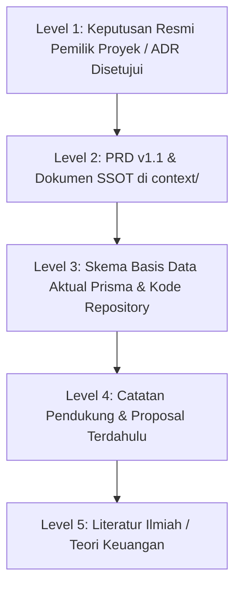
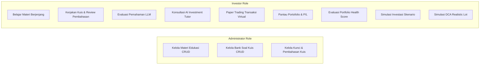
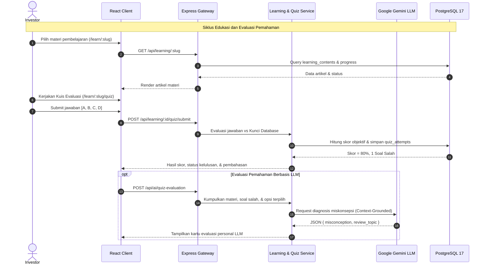
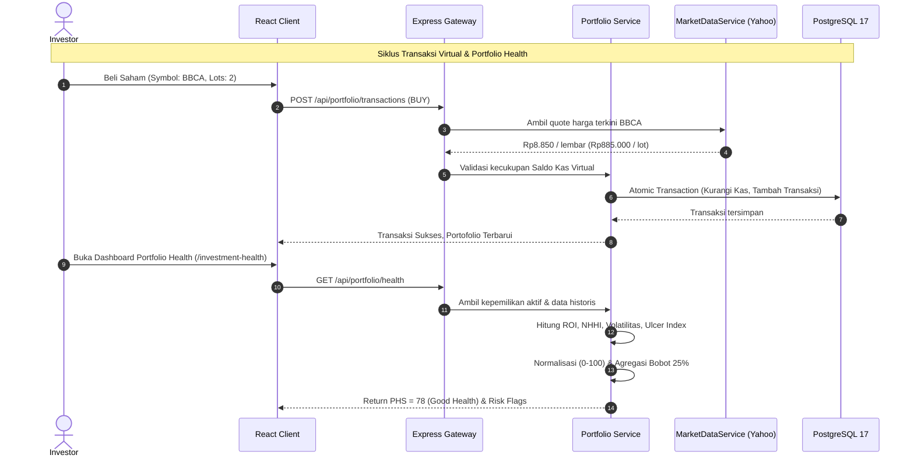
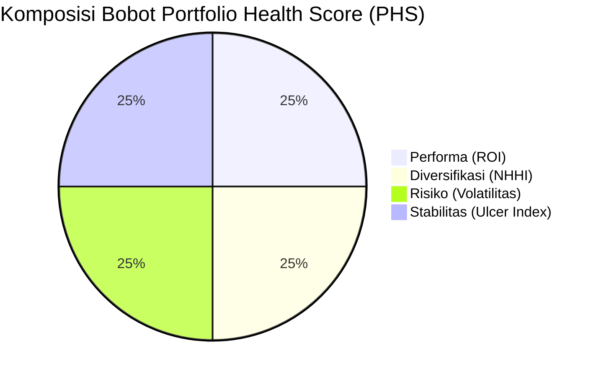
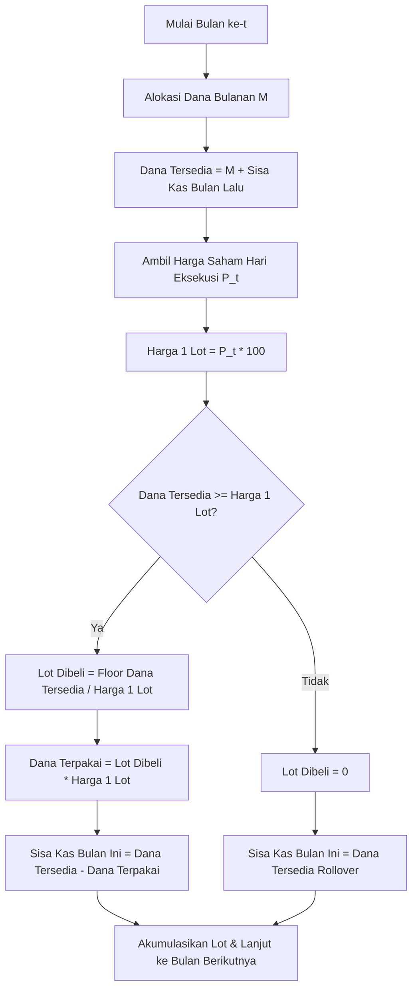
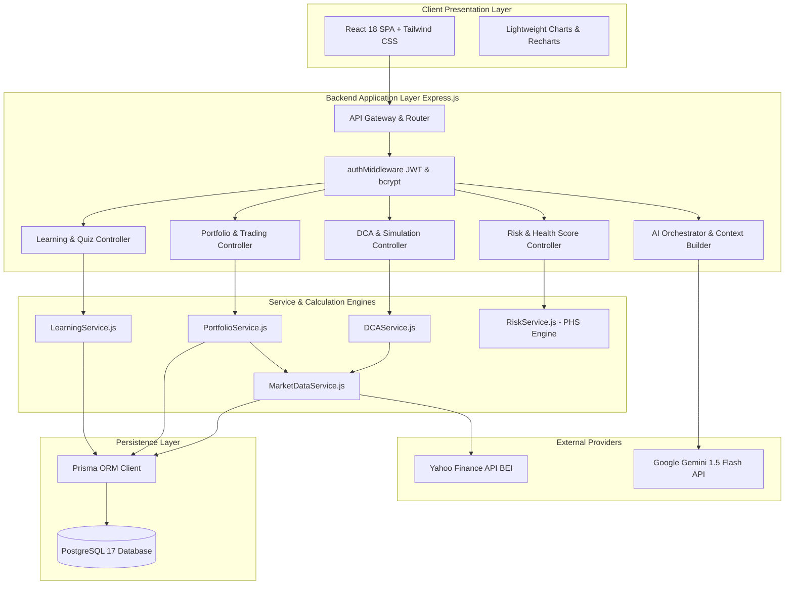
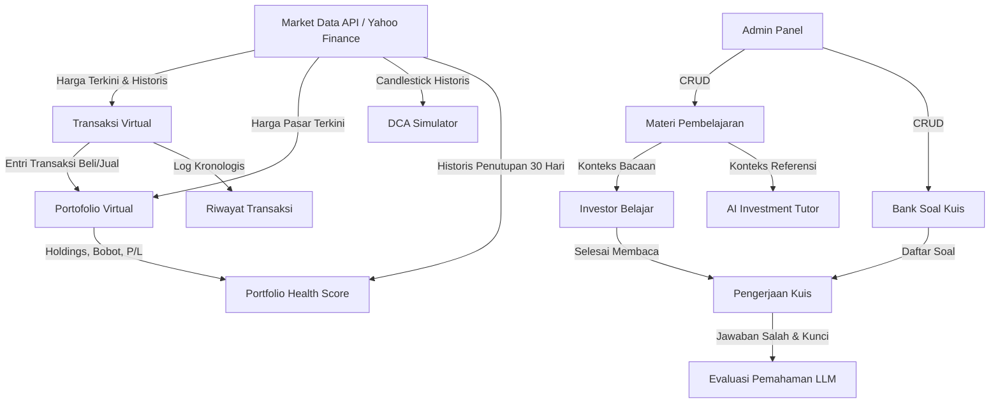

# AGENT PROJECT MEMORY
## Sub-Sistem Edukasi dan Simulasi Investasi Saham Berbasis Web

> **Dokumen Status:** Living Architecture & Specification Memory  
> **Target Pengguna Dokumen:** AI Coding Agent, Software Architect, Full-Stack Developer, AI/QA Engineer  
> **Terakhir Diperbarui:** 31 Oktober 2026  
> **Repositori Root:** `c:\laragon\www\Analisis-Saham\`  
> **Lokasi File:** `AGENT_PROJECT_MEMORY.md`  

> [!CRITICAL]
> ### 🛑 KEBIJAKAN MUTLAK GIT & GITHUB PUSH (AI AGENT PUSH RESTRICTION)
> 1. **Dilarang Keras Auto-Push oleh AI Agent**: AI Coding Agent (model/platform manapun) **TIDAK BOLEH** mengeksekusi perintah `git push` ke GitHub/remote repository secara mandiri atau otomatis.
> 2. **Eksekusi Push Hanya oleh User**: Setiap eksekusi `git push` ke GitHub adalah hak prerogatif eksklusif pengguna (User) pemilik proyek. AI Agent hanya bertugas menyiapkan kode lokal, pengujian, dan menyarankan perintah commit/push untuk dijalankan oleh User.
> 3. **Identitas Akun User Wajib Digunakan**: Setiap commit dan push git **WAJIB** membawa identitas resmi akun User:
>    - **User Name:** `firmanfarelrichardo` (atau nilai dari `git config user.name`)
>    - **User Email:** `farelpasaribu04@gmail.com` (atau nilai dari `git config user.email`)
> 4. **Larangan Identitas Bot/AI**: Dilarang keras menggunakan nama atau email bot/AI agent (seperti `antigravity`, `ai-agent`, `noreply@github.com`, dsb.) dalam riwayat commit proyek.

---

## 1. Project Identity

| Atribut | Nilai Resmi Proyek |
|---|---|
| **Judul Penelitian / Proyek** | **Rancang Bangun Sub-Sistem Edukasi dan Simulasi Investasi Saham Berbasis Web** |
| **Platform Induk Terintegrasi** | **AI-Powered Fundamental Investment Analyzer** (Sistem Analisis Fundamental & Edukasi Investasi Saham IDX Berbasis Context-Grounded AI) |
| **Identitas Sub-Sistem** | Sub-Sistem 2: Edukasi Pembelajaran Pasar Modal, Evaluasi Kuis, Simulasi Transaksi Virtual, Portofolio Virtual, Portfolio Health Score, dan Simulasi DCA |
| **Sub-Sistem Mitra (Integrasi)** | Sub-Sistem 1: Stock Analysis & AI (Katalog Emiten IDX80, Quote/Candlestick TradingView, Rasio 4 Pilar Fundamental, Berita & Sentimen Pasar, AI Financial Assistant) |
| **Target Pengguna** | Investor Ritel (Investor Pemula dan Investor Berpengalaman) serta Administrator Sistem |
| **Domain Finansial** | Saham Konstituen Bursa Efek Indonesia (BEI / IDX) dengan basis katalog utama Indeks IDX80 dan dukungan *on-demand lookup* ticker `${symbol}.JK` |
| **Karakteristik Transaksi** | **100% Virtual / Simulasi Edukatif**. Tidak terhubung ke Rekening Dana Nasabah (RDN), broker, payment gateway riil, atau eksekusi bursa nyata |
| **Teknologi Utama** | React 18, Tailwind CSS, Express.js (Node.js LTS ES6+), PostgreSQL 17, Prisma ORM, Yahoo Finance API, Google Gemini API |

---

## 2. Executive Summary

Sub-sistem ini dikembangkan untuk memecahkan kesenjangan literasi investasi saham ritel di Indonesia. Sebagian besar investor pemula terjun ke pasar modal tanpa pemahaman mendalam mengenai rasio fundamental, risiko konsentrasi modal, serta mekanisme perdagangan riil. Akibatnya, pemula rentan mengalami kerugian akibat spekulasi dan ketidakmampuan mengaudit portofolio mereka sendiri. Di sisi lain, media edukasi konvensional bersifat pasif (teks satu arah), simulator saham yang ada sering mengabaikan regulasi satuan perdagangan lot bursa (1 lot = 100 lembar) dengan menerapkan pembelian saham fraksional fiktif, serta penilaian kuis belum mampu mendeteksi letak miskonsepsi berpikir pengguna secara personal.

Sub-sistem ini mengintegrasikan lima pilar fungsional utama:
1. **Pusat Edukasi Berjenjang**: Kurikulum bertingkat (Pemula, Menengah, Mahir) yang mencakup dasar pasar modal, analisis fundamental, risiko, hingga strategi alokasi portofolio.
2. **Evaluasi Objektif & Umpan Balik Kualitatif LLM**: Pengerjaan kuis interaktif dengan penilaian otomatis berbasis kunci jawaban, dilanjutkan dengan evaluasi pemahaman berbasis model bahasa besar (*Large Language Model* - Google Gemini API) yang menelusuri kelemahan konsep tanpa mengubah nilai objektif.
3. **AI Investment Tutor**: Asisten tanya-jawab edukasi interaktif yang menjelaskan terminologi pasar modal secara kontekstual tanpa mengeluarkan instruksi spekulatif beli/jual saham.
4. **Simulasi Transaksi & Portofolio Virtual**: Lingkungan *paper trading* realistis dengan modal virtual awal, pencatatan transaksi beli/jual berbasis lot riil, kalkulasi *weighted average price*, serta pemantauan laba/rugi (*realized* dan *unrealized P/L*).
5. **Audit Risiko Portofolio & Simulasi DCA**:
   - **Portfolio Health Score (PHS)**: Indeks komposit 0–100 berbasis 4 indikator ilmiah seimbang (Performa/ROI, Diversifikasi/NHHI, Risiko/Volatilitas, dan Stabilitas/Ulcer Index).
   - **DCA Simulator**: Simulasi investasi berkala (*Dollar-Cost Averaging*) berbasis *Realistic Lot Mode* dengan akumulasi sisa kas (*cash rollover*) pada data harga historis bursa.

---

## 3. Research Objectives and Scope

### 3.1 Rumusan Masalah Penelitian
1. Bagaimana merancang dan membangun platform edukasi investasi saham berjenjang yang dilengkapi kuis interaktif dan asisten tutor AI berbasis *context-grounding*?
2. Bagaimana mengimplementasikan evaluasi pemahaman pengguna berbasis LLM yang mampu mengidentifikasi miskonsepsi konsep tanpa melakukan halusinasi fakta finansial?
3. Bagaimana membangun lingkungan simulasi transaksi virtual berbasis lot bursa Indonesia (100 lembar) yang mencatat pergerakan portofolio secara konsisten dan akuntabel?
4. Bagaimana mengukur kesehatan portofolio virtual pengguna secara objektif menggunakan indeks komposit *Portfolio Health Score* (PHS) yang mengintegrasikan performa, diversifikasi, volatilitas, dan *drawdown*?
5. Bagaimana memodelkan simulasi strategi investasi berkala (*Dollar Cost Averaging*) yang realistis dengan memperhitungkan batasan lot dan perputaran sisa dana kas?

### 3.2 Tujuan Penelitian
- Menghasilkan sub-sistem edukasi dan simulasi investasi saham berbasis web yang siap diuji secara fungsional dan empiris.
- Menyediakan kurikulum edukasi investasi berjenjang terverifikasi beserta bank soal kuis yang dikelola oleh Administrator.
- Menerapkan arsitektur *Context-Grounded LLM* pada fitur evaluasi pemahaman kuis dan AI Tutor dengan target konsistensi faktual $\ge 95\%$ dan tingkat halusinasi $< 2\%$.
- Menerapkan kalkulasi *Portfolio Health Score* (PHS) skala 0–100 dengan bobot 25% ROI, 25% NHHI, 25% Volatilitas, dan 25% Ulcer Index.
- Menyediakan simulator DCA historis berbasis kelipatan 100 lembar saham dengan mekanisme *cash rollover* otomatis.

### 3.3 Batasan Penelitian
1. **Instrumen Pasar**: Terbatas pada saham ekuitas yang tercatat di Bursa Efek Indonesia (IDX/BEI). Basis katalog utama menggunakan 80 konstituen Indeks IDX80 dengan kemampuan pencarian dinamis ticker BEI via Yahoo Finance (`${symbol}.JK`).
2. **Sifat Modal & Transaksi**: Seluruh saldo kas, portofolio, dan transaksi adalah **modal virtual**. Sistem sama sekali tidak memproses dana riil, rekening bank, atau integrasi KSEI/broker.
3. **Penyedia Data Pasar**: Menggunakan Yahoo Finance API sebagai referensi harga harian (*daily price*) dan data historis candlestick OHLCV. Data pasar tunduk pada ketersediaan dan latensi (*delayed feed* 10–15 menit).
4. **Batasan LLM**: Model LLM (Google Gemini) dibatasi perannya sebagai asisten edukasi dan evaluator kontekstual. LLM dilarang keras memberikan rekomendasi beli/jual (*trading signals*), menjamin imbal hasil, atau memprediksi harga saham masa depan.
5. **Pemisahan Tanggung Jawab Sub-Sistem**: Fitur analisis fundamental mendalam emiten, *stock screener*, *peer comparison*, serta agregasi berita makro dan sentimen pasar dikembangkan oleh Sub-Sistem 1 (Fayiz). Sub-sistem ini (Sub-Sistem 2) bertindak sebagai konsumen data emiten dan harga pasar untuk edukasi dan simulasi.

---

## 4. Source of Truth and Document Precedence

Untuk mencegah kebingungan akibat adanya draf proposal atau catatan lepas, ditetapkan aturan presedensi sumber kebenaran berikut:



### Aturan Taksonomi Label Status Informasi
Setiap entitas fitur, rumus, atau model dalam dokumen ini diklasifikasikan menggunakan label standar:
- `[DOCUMENTED]`: Tertera secara eksplisit pada PRD v1.1, modul `context/`, atau dokumen proposal resmi yang disetujui.
- `[IMPLEMENTED]`: Keberadaan fungsi, tabel, atau komponen telah diverifikasi secara fisik di dalam repositori kode.
- `[PROPOSED]`: Usulan atau ide penambahan fitur yang masih memerlukan konfirmasi/persetujuan resmi.
- `[INFERRED]`: Kesimpulan atau derivasi logis teknis berdasarkan kebutuhan terdokumentasi (perlu dibedakan dari data eksplisit).
- `[UNRESOLVED]`: Informasi yang masih ambigu, memiliki konflik antar-dokumen, atau memerlukan keputusan arsitektur lebih lanjut.

---

## 5. Actors and Permissions

Sistem mendefinisikan dua aktor utama dengan batas kewenangan yang tegas:



### 5.1 Investor
- **Hak Akses**:
  - Melakukan registrasi, login, logout, dan manajemen profil investor (`BEGINNER` / `EXPERIENCED`).
  - Membaca materi pembelajaran bertingkat (Level Pemula, Menengah, Mahir).
  - Mengerjakan kuis evaluasi pemahaman, melihat perolehan skor objektif, dan membaca pembahasan soal.
  - Memperoleh evaluasi pemahaman personal berbasis LLM pasca-kuis.
  - Berinteraksi dengan *AI Investment Tutor* untuk tanya-jawab konsep investasi.
  - Menjelajahi katalog saham IDX dan melihat grafik riwayat harga pasar sebagai acuan transaksi.
  - Melakukan transaksi beli (*BUY*) dan jual (*SELL*) saham menggunakan saldo virtual (satuan lot).
  - Melihat ringkasan portofolio virtual: alokasi aset, harga beli rata-rata, *unrealized P/L*, dan *realized P/L*.
  - Melihat riwayat transaksi virtual personal.
  - Meninjau *Portfolio Health Score* (PHS) portofolio beserta rincian 4 metrik pembentuknya.
  - Menjalankan simulasi skenario investasi saham mandiri (terisolasi dari portofolio utama).
  - Menjalankan simulasi *Dollar-Cost Averaging* (DCA) dengan *Realistic Lot Mode*.
- **Batasan**: Tidak memiliki akses terhadap menu administratif, tidak dapat mengubah kunci jawaban kuis, dan tidak dapat mengubah materi pembelajaran.

### 5.2 Administrator
- **Hak Akses**:
  - Mengakses portal/halaman administratif sistem dengan kredensial terotorisasi.
  - Mengelola data materi pembelajaran (`learning_contents`): Tambah (*Create*), Lihat (*Read*), Ubah (*Update*), dan Hapus (*Delete*). Mengatur judul, slug, kategori, tingkat kesulitan, konten markdown, dan estimasi waktu baca.
  - Mengelola bank soal kuis (`quizzes`): Menambah pertanyaan, pilihan opsi A/B/C/D, menetapkan kunci jawaban yang benar, menulis teks pembahasan detail, dan menautkannya ke materi yang sesuai.
- **Batasan**: Administrator tidak dapat bertransaksi atas nama akun Investor dan tidak dapat memanipulasi riwayat transaksi virtual pengguna secara sepihak.

---

## 6. Feature Catalog

### 6.1 Autentikasi dan Akses Pengguna `[DOCUMENTED]` `[IMPLEMENTED]`
- **ID Fitur**: `FT-AUTH-01`
- **Tujuan**: Mengotentikasi identitas pengguna, menerbitkan token sesi stateless, dan membatasi hak akses modul berdasarkan peran.
- **Aktor**: Investor, Administrator.
- **Deskripsi & Ruang Lingkup**: Pendaftaran pengguna baru, login dengan email dan password, validasi format, hashing password satu arah, penerbitan JSON Web Token (JWT), otorisasi Bearer token pada route API yang dilindungi, dan endpoint profil pengguna.
- **Prasyarat**: Koneksi database PostgreSQL 17 aktif.
- **Input**: `name`, `email`, `password`, `confirmPassword`, `investorProfile`.
- **Alur Proses**:
  1. Client mengirim payload registrasi/login ke `/api/auth/register` atau `/api/auth/login`.
  2. Backend memvalidasi format email dan panjang kata sandi (minimal 8 karakter).
  3. Pada registrasi: verifikasi email unik, hash password menggunakan `bcrypt` ($\text{salt rounds} \ge 10$), simpan ke tabel `users`.
  4. Pada login: verifikasi kecocokan hash password. Jika valid, buat token JWT dengan masa berlaku tertentu.
  5. Client menyimpan token dan menyertakannya pada header `Authorization: Bearer <token>`.
  6. Middleware `authMiddleware.js` mengekstrak token, memverifikasi tanda tangan, dan menyuntikkan data user ke objek `req.user`.
- **Aturan Bisnis**:
  - Email tidak boleh duplikat di basis data.
  - Token kedaluwarsa harus mengembalikan kode HTTP `401 Unauthorized`.
  - Password teks polos dilarang keras disimpan di basis data atau dicatat dalam log server.
- **Output**: JSON payload berisi status sukses, data profil user, dan token JWT.
- **Data Dibaca / Ditulis**: Tabel `users` (Read/Write).
- **Relasi**: Menjadi prasyarat akses untuk seluruh transaksi portofolio, pengerjaan kuis, dan progres belajar.
- **Validasi & Error**: `400 Bad Request` (input invalid), `401 Unauthorized` (kredensial salah / token expired), `409 Conflict` (email terdaftar).
- **Acceptance Criteria**: Registrasi sukses menyimpan user baru; login dengan password benar menghasilkan JWT valid; endpoint `/api/auth/me` mengembalikan profil user yang sesuai.
- **Referensi**: KF-01, PB-01, Sprint 1.

---

### 6.2 Modul Pembelajaran Investasi Saham `[DOCUMENTED]` `[IMPLEMENTED: VIEWS / PARTIAL API]`
- **ID Fitur**: `FT-EDN-01`
- **Tujuan**: Menyediakan kurikulum literasi investasi pasar modal yang terstruktur dan komprehensif bagi investor ritel.
- **Aktor**: Investor.
- **Deskripsi & Ruang Lingkup**: Menampilkan katalog pembelajaran 3 tingkat kesulitan (*Beginner, Intermediate, Advanced*) yang terbagi dalam 6 level materi:
  1. *Level 1 — Introduction*: Pengantar Investasi, Definisi Saham, BEI/IDX, IHSG, Satuan Lot, Capital Gain/Loss, Dividen.
  2. *Level 2 — Understanding Stocks*: Kapitalisasi Pasar (Big/Mid/Small Cap), Mekanisme Pembentukan Harga, Volume, Volatilitas.
  3. *Level 3 — Fundamental Metrics*: Revenue, Net Income, EPS, ROE, ROA, PER, PBV, DER, Net Profit Margin.
  4. *Level 4 — Stock Analysis*: Cara Membaca Laporan Keuangan (Laba Rugi, Neraca, Arus Kas), Pengantar Valuasi.
  5. *Level 5 — Portfolio Management*: Prinsip Diversifikasi, Risiko Konsentrasi, Manajemen Risiko Aset.
  6. *Level 6 — Investment Strategy*: Strategi DCA vs Lump Sum, Value Investing, Dividend Investing, Investasi Jangka Panjang.
- **Prasyarat**: Pengguna telah terotentikasi.
- **Input**: Slug materi (contoh: `apa-itu-roe`), parameter filter level.
- **Alur Proses**:
  1. Investor mengakses halaman `/learn` dan memilih materi berdasarkan level atau kategori.
  2. Client memanggil `GET /api/learning/:slug`.
  3. Backend mengambil rincian konten artikel dari tabel `learning_contents` beserta status pengerjaan user dari `learning_progress`.
  4. Antarmuka menampilkan teks bacaan terstruktur, ilustrasi, formula matematis, dan tombol navigasi ke kuis terkait.
  5. Investor dapat menandai materi sebagai selesai dibaca (`POST /api/learning/:id/progress`).
- **Aturan Bisnis**:
  - Seluruh materi disajikan dalam Bahasa Indonesia yang baku dan komunikatif.
  - Penandaan materi selesai bersifat independen terhadap nilai kuis, kecuali ada aturan kelulusan kuis yang menguncinya.
- **Output**: Halaman artikel edukasi lengkap dengan estimasi waktu baca dan status progres.
- **Data Dibaca / Ditulis**: Tabel `learning_contents` (Read), `learning_progress` (Read/Write).
- **Relasi**: Menjadi konteks rujukan untuk fitur kuis (`FT-QZ-01`) dan AI Investment Tutor (`FT-TUTR-01`).
- **Validasi & Error**: `404 Not Found` jika slug tidak ditemukan.
- **Acceptance Criteria**: Investor dapat membuka daftar materi per level, membaca rincian artikel tanpa pemotongan, dan melihat status penyelesaian materi.
- **Referensi**: KF-02, PB-02, Sprint 2.

---

### 6.3 Kuis Evaluasi dan Pembahasan `[DOCUMENTED]` `[INFERRED]`
- **ID Fitur**: `FT-QZ-01`
- **Tujuan**: Menguji dan mengevaluasi pemahaman objektif investor terhadap topik materi yang telah dipelajari.
- **Aktor**: Investor.
- **Deskripsi & Ruang Lingkup**: Penyajian paket soal pilihan ganda (minimal 3–5 soal per materi), pengumpulan lembar jawaban pengguna, pemeriksaan otomatis terhadap kunci jawaban, perhitungan skor persentase (0–100%), dan penyajian pembahasan detail di setiap butir soal.
- **Prasyarat**: Investor membuka materi terkait (`FT-EDN-01`).
- **Input**: Array jawaban pengguna `[{ quizId: UUID, answer: "A" | "B" | "C" | "D" }]`.
- **Alur Proses**:
  1. Investor membuka tab kuis pada materi `/learn/:slug/quiz`.
  2. Client memanggil `GET /api/learning/:id/quiz` untuk memuat daftar pertanyaan dan opsi A–D (kunci jawaban disembunyikan dari payload client).
  3. Investor memilih opsi jawaban pada seluruh butir soal dan menekan tombol kirim.
  4. Client mengirim payload ke `POST /api/learning/:id/quiz/submit`.
  5. Backend membandingkan setiap jawaban terhadap kolom `correct_answer` di tabel `quizzes`.
  6. Backend mencatat riwayat ke `quiz_attempts`, menghitung jumlah benar, dan mengkalkulasi skor:
     $$\text{Score} = \left(\frac{\text{Jumlah Jawaban Benar}}{\text{Total Soal}}\right) \times 100\%$$
  7. Jika skor $\ge 75\%$, sistem menandai materi sebagai lulus/selesai di tabel `learning_progress`.
  8. Sistem merespons dengan hasil skor, status kelulusan, dan pembahasan detail (`explanation`) setiap nomor.
- **Aturan Bisnis**:
  - Kuis dapat diulang (*retake*) tanpa batasan kuota untuk mendukung pembelajaran mandiri.
  - Kunci jawaban dan pembahasan resmi tidak boleh dibocorkan ke client sebelum jawaban dikirimkan (*anti-cheat enforcement*).
- **Output**: Skor numerik (0–100), status kelulusan, ringkasan jawaban benar/salah, dan teks pembahasan lengkap.
- **Data Dibaca / Ditulis**: Tabel `quizzes` (Read), `quiz_attempts` (Write), `learning_progress` (Update).
- **Relasi**: Hasil pengerjaan kuis menjadi input utama bagi fitur evaluasi pemahaman berbasis LLM (`FT-LLM-01`).
- **Validasi & Error**: `400 Bad Request` jika jumlah jawaban tidak lengkap atau format opsi di luar `A/B/C/D`.
- **Acceptance Criteria**: Sistem menghitung nilai dengan akurat; kunci jawaban tidak terekspos sebelum submit; pembahasan muncul setelah evaluasi selesai.
- **Referensi**: KF-03, PB-03, Sprint 2.

---

### 6.4 Evaluasi Pemahaman Pengguna Berbasis LLM `[DOCUMENTED]` `[INFERRED]`
- **ID Fitur**: `FT-LLM-01`
- **Tujuan**: Menganalisis pola kesalahan kuis pengguna secara cerdas menggunakan LLM untuk mengidentifikasi miskonsepsi konsep finansial dan memberikan umpan balik pembelajaran yang terarah.
- **Aktor**: Investor.
- **Deskripsi & Ruang Lingkup**: Fitur terpisah dari AI Tutor yang bertindak sebagai *evaluator diagnostik*. Fitur ini membaca konteks materi yang dipelajari, soal yang dijawab salah, opsi yang dipilih pengguna, kunci jawaban, dan teks pembahasan resmi, kemudian menghasilkan sintesis umpan balik analitis mengenai konsep apa yang belum dikuasai oleh pengguna.
- **Prasyarat**: Investor telah menyelesaikan kuis evaluasi (`FT-QZ-01`).
- **Input**: ID Materi, ID Hasil Percobaan Kuis (`quiz_attempt`), konteks materi terkait.
- **Alur Proses**:
  1. Pasca penilaian kuis, client memicu permintaan evaluasi pemahaman ke `POST /api/ai/quiz-evaluation`.
  2. Backend menyusun payload *grounded context*:
     - Ringkasan materi pembelajaran.
     - Butir pertanyaan yang dijawab salah oleh pengguna.
     - Pilihan jawaban pengguna vs Kunci jawaban yang benar.
     - Pembahasan resmi dari database.
  3. Backend menginjeksi *System Instruction* anti-halusinasi ke Google Gemini API (model `gemini-1.5-flash`).
  4. LLM menganalisis akar kebingungan konseptual pengguna dan menyusun saran perbaikan spesifik.
  5. Output dikembalikan dalam format JSON terstruktur (`misconception_analysis`, `recommended_review_topics`, `encouragement`).
- **Aturan Bisnis**:
  - LLM dilarang keras mengubah atau memanipulasi nilai objektif yang telah dihasilkan sistem kuis.
  - LLM dilarang mengarang penjelasan atau aturan finansial di luar konteks materi yang disuntikkan.
  - Evaluasi harus objektif, konstruktif, dan berbasis fakta materi bursa.
- **Output**: Kartu umpan balik evaluasi diagnostik yang menerangkan letak miskonsepsi berpikir pengguna dan rekomendasi sub-materi yang perlu dibaca ulang.
- **Data Dibaca / Ditulis**: Tabel `quizzes` (Read), `quiz_attempts` (Read), `learning_contents` (Read), `ai_analysis_logs` (Write).
- **Relasi**: Mengonsumsi data dari `FT-QZ-01` dan `FT-EDN-01`.
- **Validasi & Error**: Jika panggilan Gemini API mengalami timeout atau kegagalan kuota, sistem mengembalikan respon fallback ramah tanpa merusak tampilan nilai kuis utama.
- **Acceptance Criteria**: LLM menghasilkan diagnosis kesalahan yang sesuai dengan opsi salah yang dipilih pengguna tanpa halusinasi fakta baru.
- **Referensi**: KF-04, PB-04, Sprint 2.

---

### 6.5 AI Investment Tutor `[DOCUMENTED]` `[IMPLEMENTED: PARTIAL BACKEND]`
- **ID Fitur**: `FT-TUTR-01`
- **Tujuan**: Mendampingi proses belajar investor secara interaktif melalui antarmuka tanya-jawab cerdas berbasis konteks kurikulum sistem.
- **Aktor**: Investor.
- **Deskripsi & Ruang Lingkup**: Asisten virtual yang siap menjawab pertanyaan konseptual seputar investasi saham (contoh: *"Mengapa PER tinggi bisa berarti saham mahal?"* atau *"Apa bedanya ROE dengan ROA?"*). Respons disusun menggunakan analogi yang mudah dipahami pemula tanpa menghilangkan presisi istilah finansial.
- **Prasyarat**: Pengguna terotentikasi, pertanyaan berada dalam koridor edukasi pasar modal.
- **Input**: Teks pertanyaan pengguna (`prompt`), konteks halaman/materi aktif.
- **Alur Proses**:
  1. Investor mengetik pertanyaan pada komponen AI Tutor (`POST /api/ai/tutor`).
  2. Backend Context Builder mencocokkan kata kunci pertanyaan terhadap bank materi `learning_contents` untuk mengambil definisi dan rumus resmi.
  3. Backend merakit prompt terstruktur yang menggabungkan konteks materi + instruksi kepribadian tutor edukatif ramah pemula.
  4. Google Gemini API memproses request dan menghasilkan penjelasan bertahap (Definisi $\rightarrow$ Rumus $\rightarrow$ Contoh Kasus $\rightarrow$ Cara Membaca $\rightarrow$ Catatan Kritis).
  5. Respon diverifikasi terhadap guardrail anti-spekulasi sebelum dikirim ke client.
- **Aturan Bisnis**:
  - Dilarang memberikan rekomendasi beli/jual saham tertentu ("*Jangan beli saham X*", "*Segera borong saham Y*").
  - Dilarang memprediksi target harga saham masa depan.
  - Jika pengguna menanyakan hal di luar konteks pasar modal, tutor wajib menolak secara sopan dan mengarahkan kembali ke materi investasi.
  - Kunci rahasia `GEMINI_API_KEY` wajib diisolasi di lingkungan backend server.
- **Output**: Pesan penjelasan edukatif terstruktur yang dilengkapi *disclaimer* standar.
- **Data Dibaca / Ditulis**: Tabel `learning_contents` (Read), `ai_analysis_logs` (Write).
- **Relasi**: Melengkapi fitur pembelajaran artikel (`FT-EDN-01`).
- **Validasi & Error**: Validasi panjang input (maksimal 500 karakter per pertanyaan); penanganan timeout 60 detik.
- **Acceptance Criteria**: Jawaban relevan dengan konsep yang ditanyakan; tidak memuat sinyal beli/jual; format respons rapi dan mudah dicerna.
- **Referensi**: KF-05, PB-05, Sprint 2.

---

### 6.6 Informasi dan Harga Saham `[DOCUMENTED]` `[IMPLEMENTED]`
- **ID Fitur**: `FT-MKT-01`
- **Tujuan**: Menyediakan katalog data emiten, harga pasar harian terkini, dan riwayat candlestick OHLCV sebagai landasan simulasi dan transaksi virtual.
- **Aktor**: Investor, Administrator.
- **Deskripsi & Ruang Lingkup**: Integrasi dengan Yahoo Finance API (`${symbol}.JK`) untuk mengambil quote harga harian, ringkasan pergerakan IHSG/LQ45, dan bar data historis multi-timeframe. Data diakselerasi melalui tabel `api_cache` PostgreSQL JSONB dengan TTL 15 menit untuk quote harian dan 24 jam untuk data historis.
- **Prasyarat**: Provider Yahoo Finance API dapat diakses atau data cache lokal tersedia.
- **Input**: Simbol emiten (contoh: `BBCA`), parameter timeframe (`range`: `1d`, `1mo`, `1y`, `max`; `interval`: `1d`, `1wk`, `1mo`).
- **Alur Proses**:
  1. Client memanggil endpoint data pasar (`/api/stocks/:symbol/quote` atau `/api/stocks/:symbol/history`).
  2. Backend memeriksa keberadaan data valid di tabel `api_cache`.
  3. Jika cache valid (belum kedaluwarsa), backend langsung merespons data JSON dari database (*Cache Hit*).
  4. Jika cache kedaluwarsa atau belum ada (*Cache Miss*), backend memanggil Yahoo Finance API via HTTP request dengan header User-Agent resmi.
  5. Respons diparsing, divalidasi integritas angkanya, disimpan/diperbarui ke tabel `api_cache` dan `stock_daily_prices`, lalu dikirim ke client.
- **Aturan Bisnis**:
  - Menampilkan label penanda sumber data dan stempel waktu (*timestamp*) pembaruan data secara transparan.
  - Jika provider eksternal tidak dapat dihubungi (*network error*), sistem wajib menyajikan data cache terakhir yang tersedia disertai penanda peringatan keterlambatan data.
- **Output**: JSON payload berisi quote harga, perubahan persentase, volume, high, low, dan deret candlestick waktu-buka-tinggi-rendah-tutup (OHLCV).
- **Data Dibaca / Ditulis**: Tabel `stocks` (Read), `stock_daily_prices` (Read/Write), `api_cache` (Read/Write).
- **Relasi**: Menjadi dasar penetapan harga eksekusi pada transaksi virtual (`FT-VTR-01`), valuasi portofolio (`FT-PTF-01`), dan simulasi DCA (`FT-DCA-01`).
- **Validasi & Error**: `404 Not Found` jika ticker saham tidak terdaftar di IDX/Yahoo Finance; `503 Service Unavailable` jika API eksternal gagal dan cache kosong.
- **Acceptance Criteria**: Data candlestick dan quote emiten IDX80 termuat dengan akurat; respons cached di bawah 1.5 detik.
- **Referensi**: KF-06, PB-06, Sprint 3.

---

### 6.7 Transaksi Saham Virtual `[DOCUMENTED]` `[INFERRED]`
- **ID Fitur**: `FT-VTR-01`
- **Tujuan**: Memfasilitasi praktik simulasi perdagangan saham realistis (*paper trading*) menggunakan modal virtual tanpa risiko finansial nyata.
- **Aktor**: Investor.
- **Deskripsi & Ruang Lingkup**: Antarmuka eksekusi order beli (*BUY*) dan jual (*SELL*) saham ekuitas BEI. Seluruh transaksi wajib menggunakan satuan lot bursa ($1\text{ lot} = 100\text{ lembar}$). Sistem memvalidasi ketersediaan saldo kas virtual sebelum pembelian dan memvalidasi kecukupan lot kepemilikan sebelum penjualan (*strictly no short-selling*).
- **Prasyarat**: Investor memiliki akun aktif dan modal virtual awal yang mencukupi.
- **Input**: `symbol`, `transactionType` (`BUY` atau `SELL`), `lotQuantity` (integer $> 0$), `price` (harga pasar acuan per lembar).
- **Alur Proses Pembelian (BUY)**:
  1. Investor memilih emiten dan memasukkan kuantitas lot pada modal transaksi.
  2. Sistem mengambil harga pasar terkini dari `MarketDataService`.
  3. Sistem menghitung total nilai transaksi:
     $$\text{Nilai Transaksi} = \text{lotQuantity} \times 100 \times \text{price}$$
  4. Backend memverifikasi apakah $\text{Saldo Kas Virtual} \ge \text{Nilai Transaksi}$.
  5. Dalam transaksi database atomik (*Prisma Transaction*):
     - Kurangi saldo kas virtual investor.
     - Simpan entri baru ke tabel `portfolio_transactions` dengan tipe `BUY`.
     - Perbarui saldo kepemilikan dan hitung ulang harga beli rata-rata (*weighted average buy price*).
  6. Backend merespons status sukses dan mengembalikan pembaruan portofolio.
- **Alur Proses Penjualan (SELL)**:
  1. Investor memilih saham yang sedang dimiliki di portofolio dan memasukkan kuantitas lot yang ingin dijual.
  2. Backend memverifikasi apakah $\text{Lot Dimiliki} \ge \text{lotQuantity Jual}$.
  3. Sistem menghitung penerimaan dana virtual dan keuntungan/kerugian terealisasi (*Realized P/L*):
     $$\text{Realized P/L} = (\text{lotQuantity} \times 100) \times (\text{Harga Jual} - \text{Avg Buy Price})$$
  4. Dalam transaksi database atomik:
     - Tambahkan hasil penjualan ke saldo kas virtual.
     - Simpan entri transaksi ke `portfolio_transactions` dengan tipe `SELL`.
     - Kurangi kuantitas kepemilikan pada portofolio pengguna.
- **Aturan Bisnis**:
  - Nilai transaksi murni simulasi; tidak ada dana nyata atau pembebanan biaya transaksi/pajak nyata (kecuali jika parameter simulasi biaya diaktifkan).
  - Penjualan saham yang tidak dimiliki (*naked short selling*) ditolak mutlak.
  - Perubahan data wajib bersifat atomik (*ACID compliance*).
- **Output**: Notifikasi transaksi berhasil, pembaruan saldo kas virtual, dan pembaruan tabel kepemilikan saham.
- **Data Dibaca / Ditulis**: Tabel `users` (Update saldo virtual), `stocks` (Read), `portfolio_transactions` (Write).
- **Relasi**: Memperbarui portofolio virtual (`FT-PTF-01`) dan riwayat transaksi (`FT-TXH-01`).
- **Validasi & Error**: `400 Bad Request` jika lot $\le 0$; `422 Unprocessable Entity` jika saldo kas tidak mencukupi untuk BUY atau lot tidak mencukupi untuk SELL.
- **Acceptance Criteria**: Saldo kas dan kepemilikan saham berkurang/bertambah secara matematis tepat tanpa selisih pembulatan; transaksi tercatat di database.
- **Referensi**: KF-07, PB-07, Sprint 3.

---

### 6.8 Portofolio Virtual `[DOCUMENTED]` `[INFERRED]`
- **ID Fitur**: `FT-PTF-01`
- **Tujuan**: Menyajikan ikhtisar komprehensif atas seluruh aset investasi virtual pengguna beserta metrik profitabilitas dan diversifikasinya.
- **Aktor**: Investor.
- **Deskripsi & Ruang Lingkup**: Dasbor portofolio yang menampilkan:
  - Saldo Kas Virtual Tersedia (*Available Cash*).
  - Total Modal Diinvestasikan (*Total Cost Basis*).
  - Total Nilai Pasar Terkini (*Total Current Market Value*).
  - Total Nilai Portofolio ($\text{Nilai Pasar Saham} + \text{Saldo Kas}$).
  - Keuntungan/Kerugian Belum Terealisasi (*Unrealized P/L* nominal dan persentase).
  - Keuntungan/Kerugian Terealisasi (*Realized P/L* kumulatif dari transaksi jual).
  - Tabel Daftar Kepemilikan Saham (*Holdings Table*): Ticker, Nama Emiten, Jumlah Lot, Jumlah Lembar, Rata-rata Harga Beli (*Avg Price*), Harga Terkini, Nilai Pasar, dan Return (%).
  - Diagram Lingkaran Alokasi Portofolio (*Asset & Sector Allocation Pie Chart*).
- **Prasyarat**: Investor memiliki akun aktif.
- **Input**: User ID terotentikasi.
- **Alur Proses**:
  1. Investor mengakses halaman `/portfolio`.
  2. Backend mengambil seluruh riwayat transaksi user dari `portfolio_transactions` yang diurutkan secara kronologis.
  3. Mesin kalkulator portofolio (`portfolioCalculator.js`) merekonstruksi saldo kepemilikan aktif dan harga beli rata-rata tertimbang (*weighted average cost*).
  4. Backend mengambil quote harga terkini untuk seluruh ticker yang dimiliki melalui `MarketDataService`.
  5. Sistem menghitung nilai pasar saat ini, akumulasi laba/rugi, serta proporsi bobot tiap emiten dan sektor industri.
  6. Respon JSON dikirim ke client dan dirender ke dalam kartu metrik dan diagram alokasi.
- **Aturan Bisnis**:
  - Penjualan parsial saham mengurangi jumlah lembar tanpa mengubah harga beli rata-rata (*Avg Buy Price*) dari sisa saham yang masih dipegang.
  - Pemisahan tegas antara saldo kas, modal beli, dan nilai pasar.
- **Output**: Dasbor visual portofolio interaktif dan tabel rincian aset.
- **Data Dibaca / Ditulis**: Tabel `portfolio_transactions` (Read), `stocks` (Read), `stock_daily_prices` (Read).
- **Relasi**: Mengonsumsi transaksi dari `FT-VTR-01`; menjadi data masukan utama untuk Portfolio Health Score (`FT-PHS-01`).
- **Validasi & Error**: Jika portofolio masih kosong, tampilkan *empty state* informatif dengan ajakan melakukan transaksi virtual pertama.
- **Acceptance Criteria**: Seluruh formula keuangan (Avg Price, Unrealized P/L, Realized P/L, Return %) terhitung secara matematis akurat; diagram alokasi merefleksikan bobot riil.
- **Referensi**: KF-08, PB-08, Sprint 3.

---

### 6.9 Riwayat Transaksi `[DOCUMENTED]` `[IMPLEMENTED: SCHEMA / VIEWS]`
- **ID Fitur**: `FT-TXH-01`
- **Tujuan**: Menyediakan audit trail lengkap atas seluruh aktivitas transaksi virtual yang pernah dilakukan pengguna.
- **Aktor**: Investor.
- **Deskripsi & Ruang Lingkup**: Tabel riwayat transaksi yang mencatat stempel waktu transaksi, simbol emiten, tipe aksi (`BUY` atau `SELL`), volume lot, jumlah lembar, harga eksekusi per lembar, dan total nilai nominal transaksi. Mendukung pengurutan berdasarkan tanggal transaksi terbaru.
- **Prasyarat**: Pengguna telah terotentikasi.
- **Input**: User ID, parameter pagination/filter (tanggal, tipe transaksi, simbol).
- **Alur Proses**:
  1. Investor membuka tab riwayat transaksi di halaman portofolio.
  2. Client memanggil `GET /api/portfolio/transactions`.
  3. Backend mengambil seluruh entri pada tabel `portfolio_transactions` untuk `user_id` terkait dengan pengurutan `transaction_date DESC, created_at DESC`.
  4. Antarmuka menampilkan tabel riwayat transaksi yang rapi dan dapat ditelusuri.
- **Aturan Bisnis**:
  - Riwayat transaksi virtual bersifat permanen dan terikat pada akun pengguna terkait.
  - Simulasi skenario mandiri (DCA simulator) dilarang mengotori atau tercampur ke dalam tabel riwayat transaksi portofolio utama.
- **Output**: Tabel log transaksi historis.
- **Data Dibaca / Ditulis**: Tabel `portfolio_transactions` (Read).
- **Relasi**: Dihasilkan oleh `FT-VTR-01`.
- **Validasi & Error**: `200 OK` dengan array kosong jika belum ada transaksi.
- **Acceptance Criteria**: Menampilkan seluruh transaksi yang pernah dilakukan secara kronologis tanpa data yang hilang.
- **Referensi**: KF-09, PB-09, Sprint 3.

---

### 6.10 Portfolio Health Score (PHS) `[DOCUMENTED]` `[INFERRED]`
- **ID Fitur**: `FT-PHS-01`
- **Tujuan**: Mendiagnosis dan mengaudit kondisi kesehatan portofolio virtual pengguna menggunakan indeks komposit kuantitatif objektif skala 0–100.
- **Aktor**: Investor.
- **Deskripsi & Ruang Lingkup**: Menghitung indeks komposit kesehatan portofolio berbasis empat indikator seimbang (masing-masing berbobot 25%):
  1. **Performa Investasi**: *Return on Investment* (ROI) portofolio.
  2. **Diversifikasi Aset**: *Normalized Herfindahl-Hirschman Index* (NHHI) yang mengukur konsentrasi bobot modal.
  3. **Risiko Fluktuasi**: Volatilitas historis imbal hasil harian portofolio ($\sigma_p$).
  4. **Stabilitas Penurunan**: *Ulcer Index* (UI) yang mengukur kedalaman dan durasi *drawdown* portofolio.
  Hasil agregasi diklasifikasikan ke dalam 4 predikat edukatif: **High Risk (0–30)**, **Moderate Risk (31–60)**, **Good Health (61–80)**, dan **Well Diversified / Excellent (81–100)**, dilengkapi dengan kartu peringatan risiko (*Risk Flags*) dan uraian edukatif dari AI.
- **Prasyarat**: Pengguna memiliki minimal 1 saham aktif di portofolio dengan data historis harga yang memadai.
- **Input**: Data kepemilikan portofolio aktif, harga historis saham-saham dalam portofolio (minimal 30 hari bursa).
- **Alur Proses**:
  1. Investor mengakses halaman `/investment-health` (`GET /api/portfolio/health`).
  2. Backend memeriksa syarat kecukupan data. Jika portofolio kosong atau data historis kurang dari ambang minimum, kembalikan status bahwa evaluasi belum dapat dilakukan.
  3. Backend menghitung nilai masing-masing dari 4 pilar indikator:
     - Hitung ROI portofolio kumulatif.
     - Hitung NHHI konsentrasi aset.
     - Hitung standar deviasi (volatilitas) imbal hasil portofolio harian.
     - Hitung Ulcer Index penurunan dari nilai tertinggi (*drawdown*).
  4. Lakukan normalisasi linier/kategori setiap indikator ke skala 0–100 dengan arah interpretasi positif (makin tinggi makin sehat).
  5. Hitung skor akhir:
     $$\text{PHS} = 0.25 \cdot S_{\text{ROI}} + 0.25 \cdot S_{\text{NHHI}} + 0.25 \cdot S_{\text{VOL}} + 0.25 \cdot S_{\text{UI}}$$
  6. Backend mendeteksi anomali risiko ekstrem (misal: satu saham $> 50\%$ portofolio atau satu sektor industri $> 70\%$) untuk memicu *Risk Flags*.
  7. Client merender diagram gauge skor komposit, rincian 4 pilar, kartu peringatan, dan analisis naratif edukatif.
- **Aturan Bisnis**:
  - PHS murni merupakan instrumen diagnostik edukatif, bukan rekomendasi investasi legal atau garansi keuntungan.
  - Jika data historis tidak mencukupi, sistem dilarang menetapkan skor default 0 (karena menyesatkan pengguna); sistem wajib menampilkan pesan: *"Data historis belum mencukupi untuk evaluasi komprehensif"*.
- **Output**: Skor komposit (0–100), badge kategori risiko, skor per pilar (0–100), daftar peringatan risiko, dan sintesis edukatif AI.
- **Data Dibaca / Ditulis**: Tabel `portfolio_transactions` (Read), `stocks` (Read), `stock_daily_prices` (Read), `investment_health_logs` (Write jika disimpan).
- **Relasi**: Mengonsumsi data portofolio dari `FT-PTF-01`.
- **Validasi & Error**: `422 Unprocessable Entity` jika portofolio kosong, dengan pesan panduan diversifikasi bagi pemula.
- **Acceptance Criteria**: Skor terhitung sesuai bobot 25% per pilar; normalisasi konsisten; peringatan konsentrasi muncul jika batas terlampaui.
- **Referensi**: KF-10, PB-10, Sprint 3.

---

### 6.11 Simulasi Investasi Saham (Scenario Sandbox) `[DOCUMENTED]` `[INFERRED]`
- **ID Fitur**: `FT-SIM-01`
- **Tujuan**: Memungkinkan investor melakukan simulasi skenario "bagaimana jika" (*what-if scenario backtesting*) pada suatu saham dalam rentang waktu lampau secara mandiri.
- **Aktor**: Investor.
- **Deskripsi & Ruang Lingkup**: Simulasi skenario independen di mana pengguna memasukkan modal simulasi awal, memilih satu saham IDX, dan memilih periode tanggal di masa lalu. Sistem memodelkan hasil pembelian modal sekaligus (*lump sum*) dan menyajikan perbandingan nilai akhir portofolio simulasi terhadap harga saat ini.
- **Prasyarat**: Data harga historis saham yang dipilih tersedia pada database cache.
- **Input**: `symbol`, `initialCapital` (Rupiah), `startDate`, `endDate`.
- **Alur Proses**:
  1. Investor membuka halaman `/simulasi` dan mengisi parameter skenario.
  2. Backend mengambil harga penutupan (*Close*) pada `startDate` dan `endDate`.
  3. Sistem menghitung jumlah lot yang diperoleh pada `startDate`:
     $$\text{Lots} = \left\lfloor \frac{\text{initialCapital}}{\text{Price}_{\text{start}} \times 100} \right\rfloor$$
  4. Sistem menghitung sisa modal kas dan mengalikan total lembar dengan $\text{Price}_{\text{end}}$.
  5. Sistem menyajikan hasil perbandingan modal awal vs nilai akhir beserta persentase imbal hasil (*return*).
- **Aturan Bisnis**:
  - Simulasi skenario berjalan di memori/sandbox terisolasi dan **dilarang mengubah saldo kas atau portofolio transaksi virtual utama pengguna**.
  - Hasil simulasi masa lalu bukan jaminan performa masa depan (*past performance is not indicative of future results*).
- **Output**: Ringkasan performa skenario (Modal Disetor, Lot Terkumpul, Sisa Kas, Nilai Akhir, Return %).
- **Data Dibaca / Ditulis**: Tabel `stock_daily_prices` / `api_cache` (Read).
- **Relasi**: Terpisah dari portofolio utama `FT-PTF-01`.
- **Validasi & Error**: `400 Bad Request` jika tanggal mulai melebihi tanggal akhir atau data harga tanggal tersebut tidak ditemukan di bursa.
- **Acceptance Criteria**: Hasil skenario terhitung akurat dan portofolio utama pengguna tidak mengalami perubahan sama sekali.
- **Referensi**: KF-11, PB-11, Sprint 4.

---

### 6.12 Simulasi Dollar Cost Averaging (DCA) `[DOCUMENTED]` `[IMPLEMENTED: VIEWS / PARTIAL BACKEND]`
- **ID Fitur**: `FT-DCA-01`
- **Tujuan**: Memodelkan strategi akumulasi investasi berkala secara realistis dengan mematuhi aturan satuan perdagangan lot bursa Indonesia dan perputaran sisa kas.
- **Aktor**: Investor.
- **Deskripsi & Ruang Lingkup**: Simulator DCA berbasis data harga historis bursa aktual. Mengimplementasikan **Realistic Lot Mode**: pembelian saham hanya dilakukan dalam kelipatan 100 lembar (1 lot penuh). Jika alokasi dana bulanan belum mencukupi untuk membeli 1 lot, dana tersebut tidak hilang, melainkan **diakumulasikan (*cash rollover*)** ke alokasi bulan berikutnya. Menyajikan grafik perbandingan modal disetor vs nilai pasar portofolio dari bulan ke bulan serta tabel rincian transaksi bulanan.
- **Prasyarat**: Ticker saham valid dan data historis bulanan tersedia minimal untuk periode yang diminta.
- **Input**: `symbol`, `monthlyAmount` (Rupiah, misal: Rp500.000), `periodMonths` (6, 12, 24, 36 bulan), `executionDay` (tanggal 1, 15, atau 25 setiap bulan), `mode` (`REALISTIC_LOT` atau `FRACTIONAL`).
- **Alur Proses**:
  1. Investor mengisi form DCA pada `/dca` dan menekan "Mulai Simulasi" (`POST /api/dca/simulate`).
  2. Backend mengambil deret candlestick bulanan saham dari tabel cache.
  3. Sistem menginisialisasi loop simulasi per bulan $t = 1 \dots N$:
     - Hitung kas tersedia: $\text{Dana Tersedia}_t = \text{monthlyAmount} + \text{Sisa Kas}_{t-1}$.
     - Ambil harga saham pada tanggal eksekusi: $\text{Harga Lot}_t = \text{Price}_t \times 100$.
     - Hitung lot yang dapat dibeli: $\text{Lot Dibeli}_t = \lfloor \text{Dana Tersedia}_t / \text{Harga Lot}_t \rfloor$.
     - Hitung dana terpakai: $\text{Dana Terpakai}_t = \text{Lot Dibeli}_t \times \text{Harga Lot}_t$.
     - Hitung sisa kas bulan ini: $\text{Sisa Kas}_t = \text{Dana Tersedia}_t - \text{Dana Terpakai}_t$.
     - Akumulasikan total lot: $\text{Total Lot}_t = \text{Total Lot}_{t-1} + \text{Lot Dibeli}_t$.
  4. Di akhir periode, sistem menghitung nilai investasi akhir:
     $$\text{Nilai Akhir} = (\text{Total Lot}_N \times 100 \times \text{Harga Terkini}) + \text{Sisa Kas}_N$$
  5. Hitung total modal disetor: $\text{Total Modal} = \text{monthlyAmount} \times N$.
  6. Hitung Laba/Rugi Bersih dan persentase imbal hasil portofolio DCA.
  7. Kirimkan JSON hasil simulasi ke antarmuka untuk merender grafik area (*Capital vs Value*) dan tabel rincian.
- **Aturan Bisnis**:
  - Pada *Realistic Lot Mode*, kuantitas lot harus integer non-negatif.
  - Sisa kas wajib diperhitungkan ke dalam total nilai kekayaan akhir secara akuntabel.
  - Simulasi DCA tidak memengaruhi portofolio virtual utama pengguna.
- **Output**: Kartu ringkasan (Total Modal, Total Lot, Sisa Kas, Nilai Akhir, Return %), grafik linier akumulasi bulanan, dan tabel breakdown per bulan.
- **Data Dibaca / Ditulis**: Tabel `stock_daily_prices` / `api_cache` (Read).
- **Relasi**: Terpisah dari portofolio utama `FT-PTF-01`.
- **Validasi & Error**: `400 Bad Request` jika budget bulanan $\le 0$ atau periode di luar batas data historis yang tersedia.
- **Acceptance Criteria**: Mekanisme rollover kas berjalan tepat; lot yang dibeli selalu bernilai bulat; perbandingan modal vs nilai pasar divisualisasikan dengan jelas.
- **Referensi**: KF-12, PB-12, Sprint 4.

---

### 6.13 Pengelolaan Materi dan Kuis oleh Administrator `[DOCUMENTED]` `[INFERRED]`
- **ID Fitur**: `FT-ADM-01`
- **Tujuan**: Memberikan antarmuka manajemen konten (*Content Management*) bagi Administrator untuk memelihara kurikulum materi dan bank soal kuis secara mandiri.
- **Aktor**: Administrator.
- **Deskripsi & Ruang Lingkup**: Antarmuka administratif berbasis form untuk:
  - Modul Materi: Membuat materi baru, menyunting naskah materi edukasi, memperbarui estimasi menit baca, mengkategorikan level kesulitan, dan menghapus materi yang tidak relevan.
  - Modul Kuis: Menambah butir pertanyaan kuis, menyunting teks opsi pilihan A, B, C, D, menetapkan kunci jawaban yang benar, menulis pembahasan rasional di balik jawaban yang benar, dan menautkannya ke materi (`content_id`).
- **Prasyarat**: Pengguna login dengan akun berhak akses Administrator.
- **Input**:
  - Materi: `title`, `slug`, `category`, `difficulty`, `content`, `estimatedMinutes`.
  - Kuis: `contentId`, `question`, `optionA`, `optionB`, `optionC`, `optionD`, `correctAnswer`, `explanation`.
- **Alur Proses**:
  1. Admin mengakses portal `/admin/learning`.
  2. Sistem memvalidasi klaim role `ADMIN` pada token JWT.
  3. Admin mengisi form penambahan/perubahan materi atau soal kuis.
  4. Backend memvalidasi kelengkapan seluruh atribut wajib (*no empty fields*).
  5. Backend menyimpan data ke tabel `learning_contents` atau `quizzes`.
  6. Data yang baru disimpan langsung aktif dan dapat diakses oleh seluruh investor di halaman edukasi.
- **Aturan Bisnis**:
  - Menghapus materi akan memicu penghapusan berantai (*cascade delete*) terhadap kuis dan riwayat percobaan terkait sesuai relasi database.
  - Opsi jawaban benar (`correct_answer`) wajib merupakan salah satu dari karakter `'A'`, `'B'`, `'C'`, atau `'D'`.
- **Output**: Notifikasi sukses penyimpanan konten dan pembaruan tabel data admin.
- **Data Dibaca / Ditulis**: Tabel `learning_contents` (CRUD), `quizzes` (CRUD).
- **Relasi**: Menjadi penyedia data untuk `FT-EDN-01`, `FT-QZ-01`, `FT-LLM-01`, dan `FT-TUTR-01`.
- **Validasi & Error**: `401 Unauthorized` jika token tidak ada; `403 Forbidden` jika pengguna bukan Administrator; `400 Bad Request` jika field wajib kosong.
- **Acceptance Criteria**: Admin dapat menambah, mengedit, dan menghapus materi serta soal kuis dengan validasi integritas yang ketat.
- **Referensi**: KF-13, PB-13, Sprint 1.

---

## 7. Business Rules and End-to-End Workflows

Berikut adalah diagram alir end-to-end yang mengintegrasikan seluruh sub-sistem edukasi, kuis, evaluasi LLM, dan transaksi virtual:





---

## 8. LLM Evaluation and AI Investment Tutor

### 8.1 Pemisahan Arsitektur: Evaluasi Pemahaman Kuis vs AI Investment Tutor
Sistem secara tegas memisahkan dua fungsi kecerdasan buatan:

| Dimensi | Evaluasi Pemahaman Kuis (`FT-LLM-01`) | AI Investment Tutor (`FT-TUTR-01`) |
|---|---|---|
| **Tujuan** | Mendiagnosis kelemahan pemikiran dan miskonsepsi konsep pasca-kuis | Menjawab pertanyaan dan menerangkan konsep secara interaktif |
| **Pemicu (*Trigger*)** | Otomatis pasca-submit kuis jika terdapat jawaban salah | Permintaan eksplisit pengguna melalui kolom chat |
| **Input Konteks** | Soal yang salah, opsi terpilih, kunci jawaban, pembahasan resmi, teks materi | Teks pertanyaan pengguna, materi yang sedang dibuka, profil pengguna |
| **Format Output** | JSON terstruktur: analisis miskonsepsi & saran belajar | Teks naratif terstruktur (Definisi $\rightarrow$ Rumus $\rightarrow$ Contoh Kasus) |
| **Hak Evaluasi** | Memberikan diagnosis kualitatif; **Dilarang mengubah skor** | Murni penjelasan edukatif; **Dilarang memberikan sinyal transaksi** |

### 8.2 Guardrail dan Prompt Anti-Halusinasi
Setiap permintaan ke Google Gemini API wajib disuntikkan *System Instruction* berikut:

```text
SYSTEM INSTRUCTION:
Anda adalah Financial Education Evaluator dan Investment Tutor cerdas pada platform analisis investasi saham Indonesia.
Tugas Anda adalah memberikan penjelasan edukasi yang faktual, objektif, dan mudah dipahami berdasarkan data konteks yang disediakan sistem.

ATURAN KETAT (STRICT GUARDRAILS):
1. Anda HANYA diperbolehkan menggunakan fakta, rumus, definisi, dan angka yang terdapat pada CONTEXT.
2. DILARANG KERAS mengarang fakta, aksi korporasi, atau angka finansial baru (NO HALLUCINATION).
3. Jika informasi yang ditanyakan tidak tercantum di dalam CONTEXT, jawab dengan tegas:
   "Data fakta tidak tersedia pada materi yang disediakan sistem."
4. DILARANG memberikan rekomendasi investasi berupa perintah beli (Buy), jual (Sell), hold, atau cut loss.
5. DILARANG memprediksi harga saham masa depan sebagai fakta pasti.
6. Anda BUKAN penasihat keuangan berlisensi; sertakan selalu disclaimer edukasi.
```

### 8.3 Target Metrik Evaluasi Ilmiah untuk Skripsi
1. **Factual Consistency**: $\ge 95\%$ (diuji menggunakan dataset 50+ variasi pertanyaan finansial terhadap ground truth).
2. **Hallucination Rate**: $< 2\%$ (rasio penyebutan angka/fakta fiktif yang tidak ada di dalam context payload).
3. **Completeness Score**: $\ge 90\%$ (seluruh komponen pertanyaan terjawab tuntas sesuai materi rujukan).
4. **Latency Performa**: Response time rata-rata sintesis AI $< 4.0$ detik.

---

## 9. Portfolio Health Score (PHS) Specification

### 9.1 Definisi dan Filosofi Indikator
Portfolio Health Score (PHS) adalah indeks komposit berskala 0–100 yang dirancang untuk mengukur mutu kesehatan portofolio virtual pengguna dari perspektif manajemen risiko modern. Skor komposit dibentuk oleh empat indikator dengan bobot seimbang masing-masing 25%:

$$\text{PHS} = 0.25 \cdot S_{\text{ROI}} + 0.25 \cdot S_{\text{NHHI}} + 0.25 \cdot S_{\text{VOL}} + 0.25 \cdot S_{\text{UI}}$$



---

### 9.2 Formula Matematis 4 Indikator

#### 1. Performa Investasi: Return on Investment (ROI)
Mengukur efektivitas pertumbuhan modal terhadap modal awal yang diinvestasikan.
$$\text{ROI} = \left(\frac{V_t - V_0}{V_0}\right) \times 100\%$$
- $V_t$: Nilai pasar portofolio saat ini ditambah sisa kas.
- $V_0$: Total modal virtual awal yang disetor.

#### 2. Diversifikasi: Normalized Herfindahl-Hirschman Index (NHHI)
Mengukur tingkat konsentrasi alokasi aset portofolio.
$$HHI = \sum_{i=1}^N w_i^2 \quad \text{di mana } w_i = \frac{\text{Nilai Pasar Saham}_i}{\text{Total Nilai Pasar Saham}}$$
Jika jumlah saham $N > 1$:
$$NHHI = \frac{HHI - \frac{1}{N}}{1 - \frac{1}{N}}$$
Jika $N = 1$, maka $NHHI = 1.0$ (konsentrasi absolut/tanpa diversifikasi).
- *Interpretasi*: Nilai NHHI berkisar antara 0 (alokasi terdistribusi merata sempurna) hingga 1 (seluruh dana terkonsentrasi pada 1 saham).

#### 3. Risiko Fluktuasi: Volatilitas Imbal Hasil Portofolio ($\sigma_p$)
Mengukur fluktuasi harian pergerakan nilai portofolio selama periode pengamatan $T$ hari bursa (minimal 30 hari).
$$\sigma_p = \sqrt{\frac{1}{T-1} \sum_{t=1}^T (R_{p,t} - \bar{R}_p)^2}$$
- $R_{p,t}$: Imbal hasil harian portofolio pada hari $t$.
- $\bar{R}_p$: Rata-rata imbal hasil harian portofolio.

#### 4. Stabilitas Penurunan: Ulcer Index (UI)
Mengukur kedalaman (*depth*) dan durasi (*duration*) penurunan nilai portofolio dari titik tertinggi sebelumnya (*drawdown*).
$$UI = \sqrt{\frac{1}{T} \sum_{t=1}^T D_t^2}$$
Di mana persentase penurunan dari puncak tertinggi (*percentage drawdown*) pada hari $t$ adalah:
$$D_t = \left(\frac{V_t - \max_{1 \le \tau \le t} V_\tau}{\max_{1 \le \tau \le t} V_\tau}\right) \times 100\%$$
- *Interpretasi*: Nilai UI makin mendekati 0 menunjukkan portofolio yang sangat stabil tanpa koreksi tajam berkepanjangan.

---

### 9.3 Aturan Normalisasi Skor (Skala 0–100)
Setiap nilai mentah indikator dinormalisasikan ke skor 0–100 di mana nilai lebih tinggi mencerminkan kondisi yang lebih sehat:

| Indikator | Nilai Mentah | Nilai Normalisasi ($S$) | Logika & Interpretasi |
|---|---|---|---|
| **ROI** ($S_{\text{ROI}}$) | $\text{ROI} \ge +20\%$<br>$0\% \le \text{ROI} < 20\%$<br>$-15\% \le \text{ROI} < 0\%$<br>$\text{ROI} < -15\%$ | $100$<br>$50 + (\text{ROI}/20) \times 50$<br>$20 + ((\text{ROI}+15)/15) \times 30$<br>$10$ | Pertumbuhan modal positif menghasilkan skor tinggi; kerugian modal signifikan memperoleh penalti |
| **NHHI** ($S_{\text{NHHI}}$) | $NHHI \le 0.15$<br>$0.15 < NHHI \le 0.35$<br>$0.35 < NHHI \le 0.60$<br>$NHHI > 0.60$ | $100$<br>$80 - ((NHHI - 0.15)/0.20) \times 30$<br>$50 - ((NHHI - 0.35)/0.25) \times 30$<br>$20$ | Konsentrasi rendah (tersebar merata) mendapat skor mendekati 100; konsentrasi pada 1 saham diganjar skor minimal |
| **Volatilitas** ($S_{\text{VOL}}$) | $\sigma_p \le 1.0\%$ per hari<br>$1.0\% < \sigma_p \le 2.5\%$<br>$2.5\% < \sigma_p \le 4.0\%$<br>$\sigma_p > 4.0\%$ | $100$<br>$85 - ((\sigma_p - 1.0)/1.5) \times 35$<br>$50 - ((\sigma_p - 2.5)/1.5) \times 35$<br>$15$ | Fluktuasi rendah mencerminkan kestabilan; fluktuasi liar harian mendapat skor rendah |
| **Ulcer Index** ($S_{\text{UI}}$) | $UI \le 2.0$<br>$2.0 < UI \le 5.0$<br>$5.0 < UI \le 10.0$<br>$UI > 10.0$ | $100$<br>$85 - ((UI - 2.0)/3.0) \times 35$<br>$50 - ((UI - 5.0)/5.0) \times 35$<br>$15$ | Penurunan kecil dari puncak mendapat skor tinggi; drawdown dalam dan berkepanjangan mendapat penalti berat |

### 9.4 Penanganan Kondisi Batas (*Edge Cases*)
- **Portofolio Kosong**: Sistem tidak menghitung skor dan mengembalikan status code `422` atau status informatif: `"Belum Ada Portofolio Aktif"`.
- **Data Historis Kurang dari 30 Hari**: Sistem dilarang mengisi volatilitas atau Ulcer Index dengan angka nol. Tampilkan status: `"Data historis transaksi belum mencukupi (minimal 30 hari bursa) untuk evaluasi volatilitas dan drawdown"`.

---

## 10. Virtual Trading and Portfolio Rules

1. **Satuan Transaksi**:
   - Seluruh transaksi pembelian dan penjualan saham wajib dalam kelipatan **1 lot (100 lembar)**.
   - Pecahan fraksional lembar saham dilarang dalam perdagangan ekuitas BEI.
2. **Formula Harga Beli Rata-Rata (*Weighted Average Buy Price*)**:
   Setiap transaksi beli baru ($B_2$) pada saham yang telah dimiliki ($B_1$) memperbarui harga beli rata-rata secara tertimbang:
   $$\text{Avg Price}_{\text{baru}} = \frac{(Q_{\text{lama}} \times \text{Avg Price}_{\text{lama}}) + (Q_{\text{baru}} \times P_{\text{baru}})}{Q_{\text{lama}} + Q_{\text{baru}}}$$
3. **Formula Laba/Rugi Belum Terealisasi (*Unrealized P/L*)**:
   $$\text{Unrealized P/L} = Q_{\text{aktif}} \times (P_{\text{pasar terkini}} - \text{Avg Price})$$
   $$\text{Unrealized Return \%} = \left(\frac{P_{\text{pasar terkini}} - \text{Avg Price}}{\text{Avg Price}}\right) \times 100\%$$
4. **Formula Laba/Rugi Terealisasi (*Realized P/L*)**:
   Pada setiap transaksi jual (*SELL*), keuntungan/kerugian dihitung berdasarkan selisih harga jual terhadap rata-rata harga beli saat itu:
   $$\text{Realized P/L} = Q_{\text{jual}} \times (P_{\text{jual}} - \text{Avg Price})$$
5. **Integritas Penjualan (*No Short Selling*)**:
   $$Q_{\text{jual}} \le Q_{\text{aktif}}$$
   Jika kuantitas jual melebihi kepemilikan, transaksi dibatalkan seketika oleh backend.

---

## 11. Investment Simulation and DCA

### 11.1 Isolasi Skenario Sandbox
Sistem membedakan secara tegas antara:
- **Portofolio Transaksi Utama**: Mencatat saldo kas virtual dan aset pengguna secara persisten (`portfolio_transactions`).
- **Simulasi DCA & Skenario**: Berjalan sebagai simulasi komparatif independen (*stateless calculation engine*) yang tidak mengubah saldo kas maupun kepemilikan saham di portofolio utama.

### 11.2 Mekanisme Algoritma DCA *Realistic Lot Mode*
Simulasi investasi berkala bulanan dieksekusi dengan langkah-langkah presisi berikut:



Di akhir periode simulasi $N$ bulan:
$$\text{Total Lot Terkumpul} = \sum_{t=1}^N \text{Lot Dibeli}_t$$
$$\text{Total Modal Disetor} = M \times N$$
$$\text{Nilai Akhir Portofolio DCA} = (\text{Total Lot Terkumpul} \times 100 \times P_{\text{terkini}}) + \text{Sisa Kas}_N$$
$$\text{Laba/Rugi Bersih} = \text{Nilai Akhir Portofolio DCA} - \text{Total Modal Disetor}$$

---

## 12. System Architecture and Technology Stack



### Rincian Komponen Arsitektur
1. **Frontend**:
   - Single Page Application (SPA) berbasis **React 18** dan **Vite**.
   - Tata letak responsif menggunakan **Tailwind CSS** dengan dukungan penuh **Dual-Theme** (*Dark Mode* `#080808` default & *Light Mode* slate).
   - Visualisasi grafik interaktif menggunakan **TradingView Lightweight Charts** (candlestick harga) dan **Recharts** (diagram alokasi portofolio & kurva simulasi DCA).
2. **Backend**:
   - Runtime **Node.js LTS** dengan sintaks modular **ES6+**.
   - Framework **Express.js** dengan struktur arsitektur modular (*Controllers, Services, Middlewares, Routes, Utils*).
3. **Database & Caching**:
   - Database relasional utama: **PostgreSQL 17**.
   - Object-Relational Mapping (ORM): **Prisma ORM v6**.
   - Caching respons eksternal: Tabel `api_cache` PostgreSQL JSONB dengan verifikasi TTL otomatis.
4. **Environment Variables Kritis**:
   - `DATABASE_URL`: String koneksi PostgreSQL (`postgresql://...`).
   - `JWT_SECRET`: Kunci enkripsi token otorisasi sesi.
   - `GEMINI_API_KEY`: Kunci akses Google Gemini API (wajib tersimpan di backend `.env`).
   - `PORT`: Port server Express (default: `5000`).

---

## 13. Data Model and API Contracts

### 13.1 Skema Model Data Relasional (Prisma Schema)

```prisma
// Cuplikan Model Relevan dari backend/prisma/schema.prisma

enum InvestorProfile {
  BEGINNER
  EXPERIENCED
}

enum Role {
  INVESTOR
  ADMIN
}

enum LearningCategory {
  BEGINNER
  FUNDAMENTAL
  ANALYSIS
  PORTFOLIO
  STRATEGY
}

enum DifficultyLevel {
  BEGINNER
  INTERMEDIATE
  ADVANCED
}

enum TransactionType {
  BUY
  SELL
}

model User {
  id              String          @id @default(uuid()) @db.Uuid
  name            String          @db.VarChar(100)
  email           String          @unique @db.VarChar(150)
  passwordHash    String          @map("password_hash") @db.VarChar(255)
  investorProfile InvestorProfile @default(BEGINNER) @map("investor_profile")
  createdAt       DateTime        @default(now()) @map("created_at") @db.Timestamptz(6)
  updatedAt       DateTime        @default(now()) @updatedAt @map("updated_at") @db.Timestamptz(6)

  // Relasi Sub-Sistem 2
  portfolioTransactions PortfolioTransaction[]
  learningProgresses    LearningProgress[]
  quizAttempts          QuizAttempt[]

  @@map("users")
}

model LearningContent {
  id               String           @id @default(uuid()) @db.Uuid
  title            String           @db.VarChar(200)
  slug             String           @unique @db.VarChar(200)
  category         LearningCategory
  difficulty       DifficultyLevel
  content          String           @db.Text
  estimatedMinutes Int              @default(5) @map("estimated_minutes")
  createdAt        DateTime         @default(now()) @map("created_at") @db.Timestamptz(6)
  updatedAt        DateTime         @default(now()) @updatedAt @map("updated_at") @db.Timestamptz(6)

  quizzes            Quiz[]
  learningProgresses LearningProgress[]

  @@map("learning_contents")
}

model LearningProgress {
  id          String    @id @default(uuid()) @db.Uuid
  userId      String    @map("user_id") @db.Uuid
  contentId   String    @map("content_id") @db.Uuid
  completed   Boolean   @default(false)
  completedAt DateTime? @map("completed_at") @db.Timestamptz(6)

  user    User            @relation(fields: [userId], references: [id], onDelete: Cascade)
  content LearningContent @relation(fields: [contentId], references: [id], onDelete: Cascade)

  @@unique([userId, contentId])
  @@map("learning_progress")
}

model Quiz {
  id            String   @id @default(uuid()) @db.Uuid
  contentId     String   @map("content_id") @db.Uuid
  question      String   @db.Text
  optionA       String   @map("option_a") @db.VarChar(255)
  optionB       String   @map("option_b") @db.VarChar(255)
  optionC       String   @map("option_c") @db.VarChar(255)
  optionD       String   @map("option_d") @db.VarChar(255)
  correctAnswer String   @map("correct_answer") @db.VarChar(5)
  explanation   String   @db.Text

  content  LearningContent @relation(fields: [contentId], references: [id], onDelete: Cascade)
  attempts QuizAttempt[]

  @@map("quizzes")
}

model QuizAttempt {
  id        String   @id @default(uuid()) @db.Uuid
  userId    String   @map("user_id") @db.Uuid
  quizId    String   @map("quiz_id") @db.Uuid
  answer    String   @db.VarChar(5)
  isCorrect Boolean  @map("is_correct")
  createdAt DateTime @default(now()) @map("created_at") @db.Timestamptz(6)

  user User @relation(fields: [userId], references: [id], onDelete: Cascade)
  quiz Quiz @relation(fields: [quizId], references: [id], onDelete: Cascade)

  @@map("quiz_attempts")
}

model PortfolioTransaction {
  id              String          @id @default(uuid()) @db.Uuid
  userId          String          @map("user_id") @db.Uuid
  symbol          String          @db.VarChar(10)
  transactionType TransactionType @map("transaction_type")
  price           Decimal         @db.Decimal(15, 2)
  lotQuantity     Int             @map("lot_quantity")
  transactionDate DateTime        @map("transaction_date") @db.Date
  createdAt       DateTime        @default(now()) @map("created_at") @db.Timestamptz(6)

  user  User  @relation(fields: [userId], references: [id], onDelete: Cascade)
  stock Stock @relation(fields: [symbol], references: [symbol], onDelete: Restrict)

  @@index([userId])
  @@index([symbol])
  @@map("portfolio_transactions")
}
```

---

### 13.2 Katalog Kontrak REST API Sub-Sistem 2

| Method | Endpoint Path | Autentikasi | Deskripsi Singkat |
|---|---|---|---|
| `POST` | `/api/auth/register` | Publik | Registrasi akun pengguna baru |
| `POST` | `/api/auth/login` | Publik | Login & penerbitan token JWT |
| `GET` | `/api/auth/me` | Bearer JWT | Mengambil data sesi pengguna aktif |
| `GET` | `/api/learning` | Bearer JWT | Mengambil katalog kurikulum materi per level |
| `GET` | `/api/learning/:slug` | Bearer JWT | Mengambil detail artikel materi edukasi |
| `POST` | `/api/learning/:id/progress` | Bearer JWT | Menandai materi selesai dibaca |
| `GET` | `/api/learning/:id/quiz` | Bearer JWT | Mengambil butir soal kuis (kunci jawaban disembunyikan) |
| `POST` | `/api/learning/:id/quiz/submit` | Bearer JWT | Mengirim lembar jawaban kuis untuk penilaian objektif |
| `POST` | `/api/ai/quiz-evaluation` | Bearer JWT | Menganalisis miskonsepsi kuis menggunakan LLM |
| `POST` | `/api/ai/tutor` | Bearer JWT | Tanya-jawab konsep edukasi dengan AI Tutor |
| `GET` | `/api/portfolio` | Bearer JWT | Mengambil ringkasan portofolio virtual, holdings, dan P/L |
| `POST` | `/api/portfolio/transactions` | Bearer JWT | Eksekusi transaksi beli/jual saham virtual |
| `GET` | `/api/portfolio/transactions` | Bearer JWT | Mengambil riwayat log transaksi virtual |
| `DELETE`| `/api/portfolio/transactions/:id` | Bearer JWT | Menghapus entri transaksi virtual |
| `GET` | `/api/portfolio/health` | Bearer JWT | Mengambil audit skor Portfolio Health Score (PHS) |
| `POST` | `/api/dca/simulate` | Bearer JWT | Menjalankan simulasi DCA Realistic Lot Mode |
| `POST` | `/api/admin/learning` | Admin Bearer | [Admin] Membuat artikel materi edukasi baru |
| `PUT` | `/api/admin/learning/:id` | Admin Bearer | [Admin] Memperbarui artikel materi edukasi |
| `POST` | `/api/admin/quizzes` | Admin Bearer | [Admin] Menambah butir soal kuis baru |
| `PUT` | `/api/admin/quizzes/:id` | Admin Bearer | [Admin] Memperbarui butir soal, kunci, atau pembahasan |

---

## 14. Functional and Nonfunctional Requirements

### 14.1 Kebutuhan Fungsional (Functional Requirements)
- **KF-01**: Sistem harus menyediakan modul autentikasi akun (register, login, verify token) dengan enkripsi bcrypt dan stateless JWT.
- **KF-02**: Sistem harus menyajikan kurikulum materi edukasi pasar modal berjenjang 3 tingkat kesulitan dan 6 level topik.
- **KF-03**: Sistem harus menyediakan kuis evaluasi pemahaman pilihan ganda (A–D) dengan koreksi otomatis berbasis kunci jawaban.
- **KF-04**: Sistem harus mampu mendiagnosis miskonsepsi konsep pengguna pasca-kuis menggunakan model LLM yang di-grounding pada materi.
- **KF-05**: Sistem harus menyediakan fitur AI Investment Tutor interaktif yang menjawab terminologi pasar modal tanpa mengeluarkan sinyal beli/jual.
- **KF-06**: Sistem harus mengambil dan menampilkan data harga saham IDX terkini serta data historis candlestick dari penyedia pasar modal.
- **KF-07**: Sistem harus mendukung transaksi beli dan jual saham virtual berbasis satuan lot (100 lembar) dengan validasi saldo kas dan kepemilikan lot.
- **KF-08**: Sistem harus menampilkan ringkasan portofolio virtual mencakup modal disetor, nilai pasar, laba/rugi (realized & unrealized), dan alokasi aset.
- **KF-09**: Sistem harus mencatat dan menampilkan riwayat seluruh transaksi virtual pengguna secara kronologis.
- **KF-10**: Sistem harus menghitung Portfolio Health Score (PHS) skala 0–100 berbasis agregasi 4 indikator seimbang (ROI, NHHI, Volatilitas, Ulcer Index).
- **KF-11**: Sistem harus menyediakan simulasi skenario investasi mandiri yang terisolasi dari saldo portofolio utama.
- **KF-12**: Sistem harus menyediakan simulasi DCA dengan batasan kelipatan 1 lot dan mekanisme rollover sisa dana kas bulanan.
- **KF-13**: Sistem harus menyediakan antarmuka CRUD bagi Administrator untuk mengelola materi pembelajaran dan bank soal kuis.

### 14.2 Kebutuhan Nonfungsional (Non-Functional Requirements)
- **KNF-01 (Security)**: Kredensial password wajib di-hash menggunakan bcrypt ($\ge 10$ rounds); API Key eksternal wajib diisolasi di lingkungan backend server.
- **KNF-02 (Performance)**: Response time backend untuk data yang ter-cache wajib $< 1.5$ detik; latensi respons sintesis AI wajib $< 4.0$ detik.
- **KNF-03 (Data Consistency)**: Perubahan saldo kas virtual dan kepemilikan lot saham wajib bersifat atomik (*ACID transactions*) untuk mencegah anomali data.
- **KNF-04 (Availability & Fallback)**: Sistem wajib menampilkan data cache terakhir yang tersedia apabila penyedia API pasar modal eksternal mengalami gangguan.
- **KNF-05 (Usability & Responsiveness)**: Antarmuka web harus responsif pada resolusi desktop maupun perangkat mobile dengan dukungan tema Dark Mode dan Light Mode.
- **KNF-06 (Language & Clarity)**: Seluruh materi edukasi, butir kuis, dan pembahasan wajib disajikan dalam Bahasa Indonesia yang baku, komunikatif, dan mudah dipahami.
- **KNF-07 (Transparency & Disclaimers)**: Sistem wajib mencantumkan stempel waktu dan sumber data pasar serta menyertakan penanda tegas bahwa seluruh aktivitas investasi menggunakan **modal virtual edukatif**.

---

## 15. Product Backlog and Sprint Plan

Pelaksanaan pengembangan sub-sistem dibagi menjadi 4 Sprint Scrum terstruktur:

| Sprint | Modul / Fitur Sasaran | Target Backlog Item | Deliverables Utama |
|---|---|---|---|
| **Sprint 1** | **Fondasi, Akses & Manajemen Konten Admin** | `PB-01`, `PB-13` | Setup skema Prisma, Autentikasi JWT, CRUD Materi Pembelajaran Admin, CRUD Kuis Evaluasi Admin. |
| **Sprint 2** | **Pusat Edukasi, Kuis & AI Tutor** | `PB-02`, `PB-03`, `PB-04`, `PB-05` | Antarmuka Pembelajaran Berjenjang, Pengerjaan Kuis Interaktif & Scoring Otomatis, Evaluasi Pemahaman Diagnostik LLM, AI Investment Tutor. |
| **Sprint 3** | **Data Pasar, Paper Trading & Portfolio Health** | `PB-06`, `PB-07`, `PB-08`, `PB-09`, `PB-10` | Integrasi Yahoo Finance API, Transaksi Saham Virtual (Beli/Jual Lot), Dasbor Portofolio & Log Riwayat, Mesin Hitung Portfolio Health Score (PHS). |
| **Sprint 4** | **Simulasi Skenario & Dollar Cost Averaging** | `PB-11`, `PB-12` | Simulator Skenario Saham Mandiri, Simulator DCA Realistic Lot Mode dengan Cash Rollover, Pengujian Evaluasi Akhir Skripsi. |

---

## 16. Feature Dependencies and Data Flow



---

## 17. Testing Strategy and Definition of Done

### 17.1 Strategi Pengujian Komprehensif
1. **Unit Testing**:
   - Pengujian fungsi kalkulator portofolio (`portfolioCalculator.js`): average buy price, realized P/L, unrealized P/L.
   - Pengujian algoritma DCA (`DCAService.js`): pembulatan lot, pemotongan kas, akumulasi sisa kas rollover.
   - Pengujian formula PHS (`RiskService.js`): perhitungan ROI, NHHI, Volatilitas, Ulcer Index, dan normalisasi skor.
2. **Integration Testing**:
   - Pengujian endpoint otorisasi dengan token JWT valid, expired, dan tanpa token.
   - Pengujian siklus transaksi beli virtual (pemotongan saldo kas + penambahan kepemilikan saham dalam transaksi database atomik).
   - Pengujian transaksi jual (verifikasi kepemilikan lot mencukupi dan pencatatan realized gain/loss).
   - Pengujian submission kuis (pemeriksaan skor objektif vs kunci jawaban di database).
3. **AI Evaluation & Grounding Testing**:
   - Menjalankan dataset pengujian evaluasi (50 pertanyaan konsep finansial) untuk mengukur konsistensi faktual ($\ge 95\%$) dan ketiadaan halusinasi ($< 2\%$).
   - Pengujian batasan AI: memverifikasi bahwa AI menolak memberikan rekomendasi sinyal transaksi beli/jual secara otomatis.
4. **Boundary & Stress Testing**:
   - Pengujian pembelian saham dengan saldo kas pas-pasan atau tidak mencukupi harga 1 lot.
   - Pengujian perhitungan PHS pada portofolio berisi 1 saham tunggal vs multi-saham.

### 17.2 Definition of Done (DoD)
Suatu fitur dinyatakan **Selesai (Done)** hanya apabila:
1. Kode program terimplementasi sesuai kebutuhan fungsional dan aturan bisnis resmi.
2. Seluruh validasi input dan penanganan kondisi kesalahan (*error handling*) berfungsi dengan baik.
3. Transaksi data tersimpan dan terbaca secara konsisten di basis data PostgreSQL.
4. Pengujian unit dan integrasi lulus 100% tanpa regresi.
5. Antarmuka pengguna responsif, mendukung tema Dark/Light mode, dan memiliki penanganan status loading serta error yang jelas.
6. Tidak ada kunci rahasia (*API keys*) yang terekspos ke sisi client publik.
7. Dokumentasi teknis pada file memori ini diperbarui sesuai kondisi implementasi aktual.

---

## 18. Current Implementation Status

Berdasarkan audit langsung terhadap kode repositori per 19 Oktober 2026:

| Modul / Komponen | Status Implementasi | Bukti File / Lokasi Kode | Keterangan Status |
|---|---|---|---|
| **Database Schema** | `[IMPLEMENTED]` | [`backend/prisma/schema.prisma`](file:///c:/laragon/www/Analisis-Saham/backend/prisma/schema.prisma) | Tabel `users`, `stocks`, `stock_daily_prices`, `learning_contents`, `learning_progress`, `quizzes`, `quiz_attempts`, `portfolio_transactions`, dan `api_cache` telah dimigrasikan. |
| **Autentikasi JWT** | `[IMPLEMENTED]` | [`backend/src/controllers/authController.js`](file:///c:/laragon/www/Analisis-Saham/backend/src/controllers/authController.js) | Register, login, hashing bcrypt, penerbitan JWT, dan middleware `authMiddleware.js` aktif. |
| **Market Data Service** | `[IMPLEMENTED]` | [`backend/src/services/marketDataService.js`](file:///c:/laragon/www/Analisis-Saham/backend/src/services/marketDataService.js) | Integrasi Yahoo Finance (`${symbol}.JK`), caching PostgreSQL JSONB, candlestick OHLCV multi-timeframe. |
| **Frontend Layout & Shell** | `[IMPLEMENTED]` | [`frontend/src/App.jsx`](file:///c:/laragon/www/Analisis-Saham/frontend/src/App.jsx) | Header navigasi 9 menu PRD, TradingView-style Search Modal, Dark/Light Mode toggle. |
| **Stock Detail & Candlestick** | `[IMPLEMENTED]` | [`frontend/src/components/stock-detail/TradingViewChart.jsx`](file:///c:/laragon/www/Analisis-Saham/frontend/src/components/stock-detail/TradingViewChart.jsx) | Grafik Candlestick interaktif TradingView Lightweight Charts terintegrasi. |
| **Financial News & Sentiment** | `[IMPLEMENTED]` | [`backend/src/services/newsService.js`](file:///c:/laragon/www/Analisis-Saham/backend/src/services/newsService.js) | Pengambilan berita RSS CNBC/Google News + klasifikasi sentimen Google Gemini & lexicon fallback (selesai 18 Okt). |
| **Frontend View Scaffolds** | `[IMPLEMENTED]` | `frontend/src/components/views/` | Kerangka komponen `PortfolioView.jsx`, `DcaSimulatorView.jsx`, `LearningView.jsx`, `InvestmentHealthView.jsx` telah dibuat. |
| **Modul Edukasi & Kuis Backend** | `[DOCUMENTED]` / `[INFERRED]` | Backend routes/controllers belum dimigrasikan penuh | Skema database sudah ada di Prisma; endpoint router `/api/learning` perlu difinalisasi. |
| **Transaksi Virtual & PHS Backend** | `[DOCUMENTED]` / `[INFERRED]` | Backend calculation engines dalam tahap perakitan | Perlu pembuatan `PortfolioService.js` dan `RiskService.js` untuk kalkulasi 4 pilar PHS. |
| **Admin Portal CRUD** | `[IMPLEMENTED]` | [`frontend/src/components/admin/AdminDashboardPage.jsx`](file:///c:/laragon/www/Analisis-Saham/frontend/src/components/admin/AdminDashboardPage.jsx), [`backend/src/controllers/adminController.js`](file:///c:/laragon/www/Analisis-Saham/backend/src/controllers/adminController.js) | Selesai (Sprint 1): Autentikasi RBAC ADMIN, CRUD modul kurikulum 3 level, pratinjau markdown, dan CRUD bank soal kuis deterministik. |

---

## 19. Open Questions, Risks, and Conflicts

Berikut daftar ketidaksesuaian, risiko teknis, dan keputusan yang masih terbuka untuk diselesaikan:

| ID Isu | Deskripsi Masalah | Sumber Bertentangan | Dampak terhadap Sistem | Keputusan yang Diperlukan | Status |
|---|---|---|---|---|---|
| **ISSUE-01** | **Ketiadaan Kolom Role pada Tabel User** | Proposal menyebutkan peran Administrator vs Investor, namun pada `schema.prisma` model `User` hanya memiliki kolom `investorProfile` (`BEGINNER` / `EXPERIENCED`) tanpa kolom `role`. | Akses admin ke CRUD materi dan kuis belum dapat dibatasi pada level basis data. | Tambahkan enum `UserRole { INVESTOR, ADMIN }` dan kolom `role UserRole @default(INVESTOR)` pada model `User` Prisma. Telah dimigrasikan dan diintegrasikan dengan middleware `verifyAdmin`. | `RESOLVED (SPRINT 1)` |
| **ISSUE-02** | **Ketersediaan Dokumen `Evaluasi Kenaikan Level Modul.txt`** | Dokumen pendukung kenaikan level otomatis disebut dalam instruksi, namun file fisik tidak ditemukan di direktori repositori. | Mekanisme kenaikan level otomatis (*adaptive learning progression*) belum memiliki spesifikasi resmi. | Tetapkan struktur level statis (bebas dibaca) terlebih dahulu; jadikan kenaikan level otomatis sebagai usulan (`PROPOSED`) yang menunggu konfirmasi. | `UNRESOLVED` |
| **ISSUE-03** | **Penyimpanan Saldo Kas Virtual Awal** | Tabel `portfolio_transactions` mencatat kuantitas dan harga beli saham, tetapi belum ada tabel saldo kas virtual (`virtual_wallet` atau kolom `virtual_cash_balance` pada `users`). | Sistem kesulitan memvalidasi apakah uang kas virtual pengguna mencukupi saat mengeksekusi pembelian baru. | Tambahkan kolom `virtualCashBalance Decimal @default(100000000)` (misal modal awal Rp100 juta virtual) pada model `User`. | `INFERRED` |
| **ISSUE-04** | **Metode Normalisasi Ulcer Index & Volatilitas PHS** | Proposal menetapkan 4 pilar seimbang (25% per indikator), namun batas acuan numerik (*benchmark thresholds*) normalisasi UI dan $\sigma_p$ belum memiliki ketetapan baku di naskah skripsi. | Nilai normalisasi 0–100 untuk volatilitas dan drawdown berisiko bias jika rentang ambang batas tidak disepakati. | Gunakan tabel normalisasi pada Bagian 9.3 dokumen ini sebagai acuan teknis kerja, sambil menunggu konfirmasi dosen pembimbing. | `CONFIRMED AS WORKING SPEC` |
| **ISSUE-05** | **Rubrik Pengujian Akurasi Evaluasi LLM** | Evaluasi pemahaman kuis berbasis LLM memerlukan dataset ground truth untuk mengukur *Factual Consistency* dan *Hallucination Rate*. | Pengujian evaluasi skripsi di Bab 4 membutuhkan instrumen pengujian formal. | Susun file dataset evaluasi 50 butir skenario miskonsepsi kuis di folder `context/` sebelum pengujian skripsi dimulai. | `OPEN` |

---

## 20. Decisions Log

| ID Keputusan | Tanggal | Keputusan yang Ditetapkan | Justifikasi Teknis | Dampak Arsitektur |
|---|---|---|---|---|
| **ADR-M01** | 2026-09-05 | **Context-Grounded LLM Architecture** | Menghindari halusinasi data finansial numerik pada Google Gemini API. | Backend bertindak sebagai Context Builder; LLM dibatasi pada konteks data terstruktur. |
| **ADR-M02** | 2026-09-05 | **Multi-Tier PostgreSQL JSONB Caching** | Menghemat kuota rate limit Yahoo Finance dan menekan response time backend $< 1.5$ detik. | Pemanfaatan tabel `api_cache` dengan TTL granular tanpa dependensi Redis tambahan. |
| **ADR-M03** | 2026-09-05 | **Realistic Lot Mode with Cash Rollover for DCA** | Bursa Indonesia hanya memperdagangkan saham dalam kelipatan 100 lembar (1 lot); saham fraksional adalah fiktif. | Simulator DCA membatasi pembelian pada bilangan bulat lot dan mengakumulasikan sisa dana kas bulanan. |
| **ADR-M04** | 2026-09-29 | **Dual-Theme Support (Dark & Light Mode)** | Memberikan kenyamanan visual analisis pasar bagi investor pemula maupun profesional. | Standarisasi antarmuka berbasis class `dark` di Tailwind CSS dengan default mode gelap `#080808`. |
| **ADR-M05** | 2026-09-29 | **Curated Catalog IDX80 with On-Demand Fallback** | Mengoptimalkan penyimpanan basis data dan utilisasi kuota API eksternal. | Database menampung 80 emiten terlikuid BEI; ticker lain di luar IDX80 ditarik secara on-demand `${symbol}.JK`. |
| **ADR-M06** | 2026-10-18 | **Dual RSS Feeds & Gemini Financial Sentiment Integration** | Menyajikan sentimen berita pasar secara otomatis tanpa membebani pengguna membaca artikel panjang. | Agregasi feed CNBC Indonesia & Google News dengan parser sentimen Gemini Flash + fallback kamus leksikon. |
| **ADR-M07** | 2026-10-19 | **Equal-Weighted 4-Pillar Portfolio Health Score (PHS)** | Mengukur kesehatan portofolio secara komprehensif tanpa mengabaikan aspek risiko dan stabilitas. | Mengadopsi agregasi seimbang: 25% ROI, 25% NHHI, 25% Volatilitas, dan 25% Ulcer Index pada skala 0–100. |
| **ADR-M08** | 2026-10-31 | **Role-Based Access Control (RBAC) & Dedicated Admin Portal** | Memisahkan hak akses investor reguler dan administrator dalam manajemen konten kurikulum dan bank soal. | Menambahkan enum `UserRole { INVESTOR, ADMIN }` pada Prisma, middleware `verifyAdmin` di backend, dan portal rute `/admin` terproteksi di frontend. |

---

## 21. AI Agent Operating Instructions

Seluruh AI Coding Agent yang bekerja pada repositori ini **wajib mematuhi protokol operasional 5 tahap** berikut:

### 1. Sebelum Planning (*Pre-Planning Phase*)
- Wajib membaca `AGENT_PROJECT_MEMORY.md` untuk memahami batasan sistem, aturan bisnis, dan relasi antar-sub-sistem.
- Periksa status git (`git status`) untuk memastikan tidak ada perubahan kerja lokal yang terhapus atau tertimpa secara destruktif.
- Periksa apakah task yang dikerjakan termasuk dalam ruang lingkup **Sub-Sistem 2 (Edukasi & Simulasi)** atau Sub-Sistem 1 (Analisis Saham). Jangan mencampuradukkan dependensi kedua sub-sistem.

### 2. Saat Planning (*Planning Phase*)
- Pecah task besar menjadi unit-unit pekerjaan kecil yang dapat diuji (*testable increments*).
- Tentukan dependensi data: pastikan tabel database dan endpoint controller yang diperlukan sudah tersedia sebelum membangun antarmuka frontend.
- Identifikasi apakah ada aturan bisnis finansial yang relevan (misal: kelipatan 100 lembar lot, rollover sisa kas, atau normalisasi PHS).
- Ajukan pertanyaan klarifikasi kepada pengguna **hanya jika** terdapat ambiguitas kritis yang memblokir keputusan arsitektur.

### 3. Saat Building (*Implementation Phase*)
- Pertahankan struktur folder modular:
  - Backend: `backend/src/{controllers, services, routes, middleware, lib, utils}/`.
  - Frontend: `frontend/src/{components/{dashboard, layout, search, stock-detail, views, ui}, lib}/`.
- Dilarang keras menaruh kredensial rahasia (`GEMINI_API_KEY`, `JWT_SECRET`, database password) di kode client frontend.
- Selalu tangani kondisi gagal (*error handling*): respons timeout, data pasar kosong, atau saldo modal tidak cukup.
- Dilarang membuat data tiruan (*mock data*) fiktif seolah-olah data riil jika provider atau database aktif tersedia.
- Jangan pernah menandai pekerjaan selesai hanya karena tampilan UI telah dibuat tanpa integrasi data nyata.

### 4. Saat Testing & Debugging (*Verification Phase*)
- Verifikasi alur sukses (*happy path*) dan alur gagal (*edge cases / error boundaries*).
- Pastikan tidak ada regresi pada fitur yang sudah berjalan sebelumnya (seperti grafik TradingView dan Latest News).
- Periksa konsistensi matematis formula keuangan: pastikan tidak terjadi pembagian dengan nol (*division by zero*) pada perhitungan ROI, NHHI, atau P/L.

### 5. Saat Deployment & Completion (*Finalization Phase*)
- Pastikan build frontend (`npm run build`) dan linting berjalan tanpa error fatal.
- Perbarui status fitur dan log perubahan pada `AGENT_PROJECT_MEMORY.md` jika terdapat implementasi baru atau keputusan teknis yang disetujui.
- Laporkan secara transparan: fitur yang telah selesai, pengujian yang telah dilakukan, serta isu atau keputusan yang masih memerlukan masukan pengguna.

### 6. Kebijakan Mutlak Git, Commit, dan Push GitHub (Git Push & Ownership Policy)

> [!WARNING]
> **ATURAN NON-NEGOSIABEL BAGI SETIAP AI CODING AGENT**:

1. **LARANGAN EKSEKUSI `git push` SECARA OTONOM**:
   - AI Agent **DILARANG KERAS** menjalankan perintah `git push`, `git push origin <branch>`, `git push --force`, atau varian push remote lainnya ke GitHub.
   - Perintah `git push` hanya boleh dieksekusi secara manual oleh pengguna (User / Pemilik Repositori) melalui terminal lokal miliknya.
   - Setelah AI Agent menyelesaikan coding, pengujian unit/E2E, serta build verification, AI Agent **hanya diperbolehkan** merangkum perubahan dan memberitahukan User bahwa perubahan siap di-push oleh User sendiri.

2. **IDENTITAS RESMI COMMIT SELALU MEMBAWA NAMA AKUN USER**:
   - Seluruh commit git yang dibuat pada repositori ini **WAJIB** diatribusikan secara eksklusif kepada akun User:
     - **Nama Lengkap / Username Git:** `firmanfarelrichardo` (selaras dengan `git config user.name`)
     - **Alamat Email Git:** `farelpasaribu04@gmail.com` (selaras dengan `git config user.email`)
   - AI Agent dilarang keras memodifikasi konfigurasi `user.name` atau `user.email` menjadi akun bot, nama AI, atau email anonim/dummy.
   - Dilarang membuat commit dengan flag `--author` palsu atau mencantumkan AI Agent sebagai author/committer.

3. **PROTOKOL HANDOFF & SERAH TERIMA TASK**:
   - AI Agent memverifikasi bahwa `git status`, test suite, dan build lulus tanpa error.
   - Jika diminta melakukan commit lokal, pastikan pesan commit menggunakan format Conventional Commits (`feat(...)`, `fix(...)`, `chore(...)`, dll.) atas identitas user yang aktif.
   - Sediakan snippet perintah bagi User untuk melakukan review dan push mandiri, contoh:
     ```powershell
     git log -n 1
     git push origin <nama-branch>
     ```

---

## 22. Changelog

- **2026-10-31**:
  - Penambahan klausul penting pada aturan operasional AI Agent: Kebijakan mutlak larangan eksekusi `git push` otomatis oleh AI Agent ke GitHub, serta penegasan kewajiban atribusi seluruh commit & push atas nama akun User (`firmanfarelrichardo` / `farelpasaribu04@gmail.com`).
- **2026-10-19**:
  - Inisialisasi komprehensif dokumen `AGENT_PROJECT_MEMORY.md` sebagai memori hidup (*living project memory*) sub-sistem edukasi dan simulasi investasi saham.
  - Dokumentasi pemetaan 13 katalog fitur lengkap beserta ID, input, proses, aturan bisnis, output, dan acceptance criteria.
  - Dokumentasi spesifikasi ilmiah 4 pilar Portfolio Health Score (ROI, NHHI, Volatilitas, Ulcer Index) berbobot seimbang 25%.
  - Dokumentasi aturan Realistic Lot Mode dan cash rollover pada simulasi DCA.
  - Pencatatan daftar konflik, isu terbuka (ketiadaan role Admin di tabel user, virtual cash balance), dan instruksi protokol AI agent.
