# PROTOTYPE SPECIFICATION & DESIGN SYSTEM (STITCH AI)
## Sub-Sistem Edukasi & Simulasi Investasi Saham Berbasis Web

> **Target Penggunaan:** Input Master Prompt & Design Specification untuk **Stitch AI / Visual Prototyping Engine**  
> **Ruang Lingkup:** Seluruh fitur Sub-Sistem 2 (Edukasi Investasi, Kuis Evaluasi, Evaluasi Diagnostik LLM, AI Investment Tutor, Paper Trading Transaksi Virtual, Portofolio Virtual, Portfolio Health Score, Simulasi DCA Realistic Lot, dan Portal Admin)  
> **File Output:** `STITCH_PROTOTYPE_EDUKASI_SIMULASI.md`  
> **Platform & Viewport:** Web Desktop (1440 × 900 px) & Responsive Tablet/Mobile Friendly  
> **Tema Desain:** Modern Dark Terminal (Default `#080808`) & Clean Institutional Slate Mode  

---

## 1. Design System & Visual Tokens

Gunakan pedoman visual berikut untuk seluruh layar agar antarmuka prototipe terlihat premium, setara platform institusional (TradingView / Bloomberg Terminal / Linear App):

### 1.1 Palet Warna (Color Tokens)
- **Background Utama (Dark)**: `#080808` (Deep Obsidian Black)
- **Surface / Card Background**: `#121212` (Elevated Card), `#18181B` (Interactive Card / Hover)
- **Border & Separator**: `#27272A` (Subtle 1px border), `#3F3F46` (Active Border)
- **Teks Utama**: `#F4F4F5` (High Contrast White)
- **Teks Sekunder / Meta**: `#A1A1AA` (Muted Zinc Grey), `#71717A` (Tertiary Label)
- **Aksen Primer (Brand & Action)**: `#3B82F6` (Electric Blue) & `#6366F1` (Indigo AI Accent)
- **Status Positif / Profit / Gain**: `#10B981` (Emerald Green) & Gradien Soft Emerald Glow
- **Status Negatif / Loss / Warning**: `#F43F5E` (Rose Coral) & Soft Rose Glow
- **Status Waspada / Caution**: `#F59E0B` (Amber Orange)
- **Badge Edukasi & AI**: Gradien Violet-Indigo `from-indigo-600/20 to-purple-600/20` border `border-indigo-500/30`

### 1.2 Tipografi & Ikonografi
- **Font Utama**: *Inter* atau *Plus Jakarta Sans* (Sans-serif modern, tracking tight pada heading)
- **Font Angka & Finansial**: *JetBrains Mono* atau font monospaced angka untuk harga, lot, dan P/L
- **Icon Set**: Lucide Icons (stroke width: 1.75px)
- **Komponen Kartu**: Rounded corners `rounded-2xl`, border halus `border border-zinc-800/80`, drop-shadow lembut `shadow-xl shadow-black/40`

---

## 2. Global Layout Shell & Persistent Navigation

### 2.1 Top App Header Bar
```
┌────────────────────────────────────────────────────────────────────────────────────────────────────────┐
│ [Logo IDX Circle] INVESTAI   | Pasar: IHSG 7.285,4 (+0.42%) | LQ45 980,2 (+0.31%)                      │
│ ────────────────────────────────────────────────────────────────────────────────────────────────────── │
│ Navigasi: [Dashboard]  [Edukasi]  [Portofolio]  [Simulasi DCA]  [Health Score]  [AI Tutor]             │
│ Kanan: [Pencarian Cepat ⌘K]  [Modal Virtual: Rp100.000.000]  [Mode Gelap 🌙]  [Avatar: Investor Pemula]│
└────────────────────────────────────────────────────────────────────────────────────────────────────────┘
```
- **Virtual Balance Pill**: Menampilkan badge kapsul mencolok: `Rp100.000.000 (Modal Virtual)` dengan ikon dompet virtual hijau.
- **Role Badge**: Tag kecil di samping nama profil: `Investor (Pemula)` atau `Administrator`.

---

## 3. Katalog Layar Prototipe & Komponen Detail (Screen Breakdown)

---

### LAYAR 1: Katalog Kurikulum Edukasi Berjenjang (`/learn`)
**Tujuan Layar:** Menampilkan jalur kurikulum investasi terstruktur 6 level dengan 3 tingkatan kesulitan bagi investor pemula hingga mahir.

```
┌────────────────────────────────────────────────────────────────────────────────────────────────────────┐
│ HEADER: Pusat Pembelajaran Investasi Saham                                                             │
│ Sub-header: Kuasai analisis pasar modal dari nol hingga strategi portofolio berbasis data riil BEI.   │
│                                                                                                        │
│ FILTER TINGKAT: [ Semua ]  [ 🟢 Pemula (Beginner) ]  [ 🟡 Menengah ]  [ 🔴 Mahir (Advanced) ]          │
│ PROGRES GLOBAL: [██████████░░░░░░░░░░░░] 35% Selesai (4 dari 12 Modul Telah Dikuasai)                 │
├────────────────────────────────────────────────────────────────────────────────────────────────────────┤
│ GRID KARTU LEVEL MODUL (3 Kolom Responsif):                                                            │
│                                                                                                        │
│ ┌──────────────────────────────┐ ┌──────────────────────────────┐ ┌──────────────────────────────┐     │
│ │ LEVEL 1: DASAR PASAR MODAL   │ │ LEVEL 2: MEMAHAMI SAHAM      │ │ LEVEL 3: RASIO FUNDAMENTAL   │     │
│ │ Badge: 🟢 Pemula • 6 Materi  │ │ Badge: 🟢 Pemula • 5 Materi  │ │ Badge: 🟡 Menengah • 8 Materi│     │
│ │ Progres: [████████████] 100% │ │ Progres: [████████░░░░] 60%  │ │ Progres: [░░░░░░░░░░░░] 0%   │     │
│ │ • Mengenal Saham, BEI & IHSG │ │ • Market Cap (Big/Mid/Small) │ │ • Laba Bersih & EPS          │     │
│ │ • Mekanisme Satuan Lot       │ │ • Mekanisme Harga & Volume   │ │ • Price to Earnings (PER)    │     │
│ │ • Capital Gain vs Loss       │ │ • Dividen & Corporate Action │ │ • Price to Book Value (PBV)  │     │
│ │ Kuis: [Lulus: Skor 100%]     │ │ Kuis: [Belum Dikerjakan]     │ │ Kuis: [Terkunci]             │     │
│ │ [Buka Modul Level 1 →]       │ │ [Lanjutkan Belajar →]        │ │ [Buka Modul Level 3 →]       │     │
│ └──────────────────────────────┘ └──────────────────────────────┘ └──────────────────────────────┘     │
│                                                                                                        │
│ ┌──────────────────────────────┐ ┌──────────────────────────────┐ ┌──────────────────────────────┐     │
│ │ LEVEL 4: ANALISIS LAP KEU    │ │ LEVEL 5: MANAJEMEN RISIKO    │ │ LEVEL 6: STRATEGI INVESTASI  │     │
│ │ Badge: 🟡 Menengah • 6 Materi│ │ Badge: 🔴 Mahir • 5 Materi   │ │ Badge: 🔴 Mahir • 6 Materi   │     │
│ │ • Laporan Laba Rugi & Neraca │ │ • Bahaya Konsentrasi Modal   │ │ • Strategi Dollar-Cost Avg   │     │
│ │ • Membaca Arus Kas Operasi   │ │ • Diversifikasi Lintas Sektor│ │ • Lump Sum vs Berkala        │     │
│ │ • Pengantar Valuasi Wajar    │ │ • Indeks Herfindahl (HHI)    │ │ • Value & Dividend Strategy  │     │
│ └──────────────────────────────┘ └──────────────────────────────┘ └──────────────────────────────┘     │
└────────────────────────────────────────────────────────────────────────────────────────────────────────┘
```
- **Elemen Interaktif:**
  - Klik kartu membuka daftar topik sub-artikel.
  - Kartu menampilkan penanda status `Tuntas`, `Sedang Berjalan`, atau `Tersedia`.

---

### LAYAR 2: Detail Artikel Pembelajaran (`/learn/:slug`)
**Contoh Topik:** `Pengenalan Return on Equity (ROE)`

```
┌────────────────────────────────────────────────────────────────────────────────────────────────────────┐
│ Breadcrumb: Belajar > Level 3: Rasio Fundamental > Memahami Return on Equity (ROE)                     │
│ Estimasi Baca: ⏱️ 5 Menit  |  Tingkat: 🟡 Menengah  |  Status: [ Belum Selesai ]                        │
├────────────────────────────────────────────────────────────────────────────────────────────────────────┤
│ JUDUL: Mengukur Efisiensi Pengelolaan Modal Perusahaan dengan ROE                                     │
│                                                                                                        │
│ 1. Apa itu Return on Equity (ROE)?                                                                     │
│    Return on Equity (ROE) adalah rasio profitabilitas yang membandingkan laba bersih perusahaan        │
│    terhadap total modal (ekuitas) yang ditanamkan oleh pemegang saham...                               │
│                                                                                                        │
│ ┌────────────────────────────────────────────────────────────────────────────────────────────────────┐ │
│ │ FORMULA MATEMATIS RESMI:                                                                           │ │
│ │                  Laba Bersih (Net Income)                                                          │ │
│ │       ROE (%) = ────────────────────────── × 100%                                                  │ │
│ │                   Total Ekuitas (Equity)                                                           │ │
│ └────────────────────────────────────────────────────────────────────────────────────────────────────┘ │
│                                                                                                        │
│ 2. Studi Kasus Nyata di Bursa Efek Indonesia:                                                         │
│    Emiten BBCA membukukan laba bersih Rp48 Triliun dengan ekuitas Rp240 Triliun:                       │
│    ROE = (48 Triliun / 240 Triliun) * 100% = 20.0%                                                    │
│    Artinya: Setiap Rp100 modal pemegang saham mampu menghasilkan laba bersih Rp20 per tahun.           │
│                                                                                                        │
│ 3. Batas Acuan Interpretasi bagi Investor:                                                             │
│    • ROE > 15%: Sangat Sehat & Efisien                                                                 │
│    • ROE 8% - 15%: Rata-rata Industri                                                                  │
│    • ROE < 8%: Kurang Efisien                                                                          │
│                                                                                                        │
│ ┌────────────────────────────────────────────────────────────────────────────────────────────────────┐ │
│ │ KOTAK TANYA CEPAT KE AI TUTOR:                                                                     │ │
│ │ "Belum paham mengapa ROE bisa tinggi karena utang besar? Tanyakan ke AI Tutor sekarang!"           │ │
│ │ [ Tanya AI tentang ROE ✨ ]                                                                        │ │
│ └────────────────────────────────────────────────────────────────────────────────────────────────────┘ │
│                                                                                                        │
│ NAVIGASI BAWAH:                                                                                        │
│ [← Materi Sebelumnya]      [ Tandai Selesai Dibaca ✓ ]      [ Mulai Kuis Uji Pemahaman (5 Soal) → ]     │
└────────────────────────────────────────────────────────────────────────────────────────────────────────┘
```

---

### LAYAR 3: Runner Kuis Interaktif (`/learn/:slug/quiz`)
**Tujuan Layar:** Menguji pemahaman objektif pengguna secara interaktif sebelum evaluasi diagnostik.

```
┌────────────────────────────────────────────────────────────────────────────────────────────────────────┐
│ HEADER KUIS: Evaluasi Pemahaman — Level 3: Return on Equity (ROE)                                      │
│ Progres Soal: [ 2 dari 5 Soal ]  |  Waktu Pengerjaan: Mandiri Tanpa Batas Waktu                        │
├────────────────────────────────────────────────────────────────────────────────────────────────────────┤
│ PERTANYAAN NO. 2 DARI 5:                                                                               │
│ "Sebuah perusahaan memiliki laba bersih Rp10 Miliar dan total ekuitas Rp50 Miliar.                    │
│ Berapakah nilai Return on Equity (ROE) perusahaan tersebut dan apa artinya?"                           │
│                                                                                                        │
│ OPSI PILIHAN JAWABAN:                                                                                  │
│                                                                                                        │
│ ┌────────────────────────────────────────────────────────────────────────────────────────────────────┐ │
│ │ ( ) A. 500%, artinya perusahaan memiliki utang 5 kali lipat dari modal                            │ │
│ └────────────────────────────────────────────────────────────────────────────────────────────────────┘ │
│ ┌────────────────────────────────────────────────────────────────────────────────────────────────────┐ │
│ │ (•) B. 20%, artinya setiap Rp100 ekuitas mampu menghasilkan laba bersih Rp20 (TERPILIH)           │ │
│ └────────────────────────────────────────────────────────────────────────────────────────────────────┘ │
│ ┌────────────────────────────────────────────────────────────────────────────────────────────────────┐ │
│ │ ( ) C. 5%, artinya perusahaan mengalami kerugian operasional tahunan                               │ │
│ └────────────────────────────────────────────────────────────────────────────────────────────────────┘ │
│ ┌────────────────────────────────────────────────────────────────────────────────────────────────────┐ │
│ │ ( ) D. 200%, artinya valuasi harga saham di bursa sedang sangat murah                             │ │
│ └────────────────────────────────────────────────────────────────────────────────────────────────────┘ │
│                                                                                                        │
│ [← Soal Sebelumnya]                                                      [ Soal Berikutnya (3/5) → ]   │
│                                                                           [ Kirim Jawaban Kuis 🚀 ]    │
└────────────────────────────────────────────────────────────────────────────────────────────────────────┘
```

---

### LAYAR 4 & 5: Hasil Kuis + Evaluasi Miskonsepsi Berbasis LLM (`/learn/:slug/quiz/result`)
**Tujuan Layar:** Menyajikan nilai objektif, kunci/pembahasan, dan diagnosis cerdas Google Gemini atas miskonsepsi berpikir pengguna.

```
┌────────────────────────────────────────────────────────────────────────────────────────────────────────┐
│ HASIL EVALUASI KUIS PEMAHAMAN                                                                          │
├────────────────────────────────────────────────────────────────────────────────────────────────────────┤
│ ┌──────────────────────────────────────┐  ┌─────────────────────────────────────────────────────────┐  │
│ │ SKOR AKHIR OBJEKTIF                  │  │ RINGKASAN STATUS KELULUSAN                              │  │
│ │                                      │  │                                                         │  │
│ │            80 / 100                  │  │ Status: 🟢 LULUS (Ambang Kelulusan: ≥ 75%)               │  │
│ │       [ 4 Benar • 1 Salah ]          │  │ Waktu Selesai: 19 Okt 2026, 17:15 WIB                   │  │
│ │                                      │  │ Modul "Return on Equity" otomatis ditandai SELESAI.     │  │
│ └──────────────────────────────────────┘  └─────────────────────────────────────────────────────────┘  │
│                                                                                                        │
│ ┌────────────────────────────────────────────────────────────────────────────────────────────────────┐ │
│ │ ✨ EVALUASI DIAGNOSTIK PEMAHAMAN AI (GOOGLE GEMINI 1.5 FLASH)                                      │ │
│ │ Berdasarkan analisis lembar jawaban Anda terhadap materi Return on Equity:                        │ │
│ │                                                                                                    │ │
│ │ 🔍 Miskonsepsi Terdeteksi pada Soal No. 4:                                                         │ │
│ │ Anda memilih opsi C (mengira ROE tinggi selalu menjamin dividen besar). Berdasarkan data materi:   │ │
│ │ "Laba bersih yang dihasilkan (ROE tinggi) tidak otomatis dibagikan sebagai dividen. Emiten dapat   │ │
│ │ menahan laba tersebut sebagai Retained Earnings untuk mendanai ekspansi pabrik baru."              │ │
│ │                                                                                                    │ │
│ │ 💡 Rekomendasi Langkah Belajar Anda:                                                               │ │
│ │ 1. Baca ulang sub-bab "Perbedaan Laba Ditahan vs Pembayaran Dividen" di Level 1.                   │ │
│ │ 2. Anda sudah sangat memahami kalkulasi matematis ROE (Soal 1, 2, 3 benar 100%).                    │ │
│ └────────────────────────────────────────────────────────────────────────────────────────────────────┘ │
│                                                                                                        │
│ PEMBAHASAN LENGKAP SETIAP BUTIR SOAL:                                                                  │
│ • Soal 1: Definisi ROE ── [ ✓ BENAR ] Pembahasan: ROE mengukur laba bersih terhadap ekuitas modal.     │
│ • Soal 2: Hitungan Kasus ── [ ✓ BENAR ] Pembahasan: (10M / 50M) * 100% = 20%.                         │
│ • Soal 4: Kaitan Dividen ── [ ✗ SALAH - Jawaban Anda: C | Kunci Resmi: B ]                           │
│   Pembahasan Resmi: Kebijakan dividen diputuskan dalam RUPS berdasarkan Dividend Payout Ratio (DPR).   │
│                                                                                                        │
│ [ Ulangi Kuis (Retake) ↺ ]                                   [ Lanjut ke Materi Berikutnya → ]         │
└────────────────────────────────────────────────────────────────────────────────────────────────────────┘
```

---

### LAYAR 6: AI Investment Tutor Drawer / Full Page (`/ai/tutor`)
**Tujuan Layar:** Asisten tanya-jawab interaktif pendamping edukasi yang mematuhi guardrail anti-spekulasi.

```
┌────────────────────────────────────────────────────────────────────────────────────────────────────────┐
│ AI INVESTMENT TUTOR  [Online • Google Gemini Context-Grounded]                                         │
│ Sub-header: Asisten belajar konsep pasar modal. Tidak memberikan rekomendasi beli/jual saham.          │
├────────────────────────────────────────────────────────────────────────────────────────────────────────┤
│ AREA PERCAKAPAN:                                                                                       │
│                                                                                                        │
│ 🧑 Investor:                                                                                          │
│ "Saya masih bingung, mengapa investor tetap memperhatikan PBV padahal sudah ada rasio PER?"            │
│                                                                                                        │
│ 🤖 AI Tutor:                                                                                           │
│ Halo! Pertanyaan yang sangat bagus. Mari kita bedah perbedaannya dengan analogi sederhana:             │
│                                                                                                        │
│ 1. Definisi & Sudut Pandang:                                                                           │
│    • PER (Price to Earnings): Membandingkan harga saham terhadap LABA BERSIH tahunan perusahaan.       │
│      Analogi: Mengukur berapa tahun uang Anda kembali dari keuntungan bisnisnya.                       │
│    • PBV (Price to Book Value): Membandingkan harga saham terhadap NILAI BUKU ASET BERSIH (Ekuitas).   │
│      Analogi: Mengukur berapa harga yang Anda bayar dibanding nilai aset riil jika perusahaan bubar.   │
│                                                                                                        │
│ 2. Kapan PBV Sangat Krusial?                                                                           │
│    Pada sektor keuangan/perbankan (seperti BBCA, BBRI, BMRI), PBV adalah indikator utama karena aset   │
│    bank mayoritas berupa uang kas dan instrumen likuid.                                                │
│                                                                                                        │
│ 3. Hal yang Perlu Diperhatikan:                                                                        │
│    Saham dengan PBV < 1x sering dianggap 'undervalued', tetapi tetap cek apakah perusahaannya tidak    │
│    sedang mengalami penurunan kualitas laba atau jeratan utang tinggi (DER).                          │
│                                                                                                        │
│ 📌 Disclaimer: Penjelasan ini ditujukan untuk edukasi pemahaman rasio finansial, bukan ajakan transaksi│
├────────────────────────────────────────────────────────────────────────────────────────────────────────┤
│ REKOMENDASI PERTANYAAN POPULER:                                                                        │
│ [ "Apa beda Lot dengan Lembar?" ]  [ "Bagaimana cara membaca DER?" ]  [ "Apa risiko DCA?" ]            │
│                                                                                                        │
│ INPUT: [ Tulis pertanyaan konsep investasi saham Anda di sini...                            ] [Kirim ↵]│
└────────────────────────────────────────────────────────────────────────────────────────────────────────┘
```

---

### LAYAR 7: Modal Eksekusi Transaksi Saham Virtual (Paper Trading)
**Tujuan Layar:** Form eksekusi order beli/jual virtual berbasis lot bursa dengan kalkulasi instan.

```
┌────────────────────────────────────────────────────────────────────────────────────────────────────────┐
│ POPUP MODAL: Transaksi Saham Virtual                                                                   │
│ Emiten: PT Bank Central Asia Tbk (BBCA.JK)  |  Harga Pasar Terkini: Rp8.850 / lembar                   │
├────────────────────────────────────────────────────────────────────────────────────────────────────────┤
│ TAB AKSI:  [ 🟢 BELI SAHAM (BUY) ]       [ 🔴 JUAL SAHAM (SELL) ]                                      │
│                                                                                                        │
│ Saldo Kas Virtual Tersedia: Rp100.000.000                                                              │
│                                                                                                        │
│ Kuantitas Pembelian (Satuan Lot):                                                                      │
│ [ - ]  [   5   ] Lot  [ + ]   (Setara: 500 Lembar Saham)                                              │
│                                                                                                        │
│ RINCIAN KALKULASI TRANSAKSI:                                                                           │
│ • Harga Per Lembar        : Rp8.850                                                                    │
│ • Harga Per Lot (100 lbr) : Rp885.000                                                                  │
│ • Total Nilai Pembelian   : Rp4.425.000                                                                │
│ • Estimasi Biaya Bursa    : Rp0 (Simulasi Bebas Biaya Transaksi)                                       │
│ ──────────────────────────────────────────────────────────────                                         │
│ Sisa Saldo Kas Setelah Beli : Rp95.575.000                                                             │
│                                                                                                        │
│ ⚠️ Catatan Edukasi: Transaksi ini menggunakan saldo virtual untuk melatih manajemen modal tanpa risiko.│
│                                                                                                        │
│ [ Batal ]                                                     [ Konfirmasi Beli 5 Lot BBCA 🚀 ]        │
└────────────────────────────────────────────────────────────────────────────────────────────────────────┘
```

---

### LAYAR 8: Dasbor Portofolio Virtual Lengkap (`/portfolio`)
**Tujuan Layar:** Rekapitulasi modal, nilai pasar, laba/rugi harian & kumulatif, diagram alokasi, dan daftar saham aktif.

```
┌────────────────────────────────────────────────────────────────────────────────────────────────────────┐
│ HEADER: Portofolio Investasi Virtual                                                                   │
│ Sub-header: Pantau pertumbuhan modal virtual, rata-rata harga perolehan, dan alokasi aset Anda.        │
├────────────────────────────────────────────────────────────────────────────────────────────────────────┤
│ 4 KARTU METRIK UTAMA (KPI):                                                                            │
│ ┌───────────────────────────┐ ┌───────────────────────────┐ ┌───────────────────────────┐ ┌──────────┐ │
│ │ TOTAL NILAI PORTOFOLIO    │ │ TOTAL MODAL DISETOR       │ │ LABA/RUGI BELUM TEREALISASI│ │KAS BEBAS │ │
│ │ Rp105.850.000             │ │ Rp94.200.000              │ │ +Rp11.650.000 (+12.36%) 🟢 │ │Rp11.650K │ │
│ │ (Saham + Kas Tersedia)    │ │ Total Kas Dibelikan Saham │ │ Performa Positif           │ │Siap Beli │ │
│ └───────────────────────────┘ └───────────────────────────┘ └───────────────────────────┘ └──────────┘ │
│                                                                                                        │
│ DIAGRAM ALOKASI PORTOFOLIO (2 Kolom):                                                                  │
│ ┌──────────────────────────────────────────────┐ ┌───────────────────────────────────────────────────┐ │
│ │ ALOKASI BERDASARKAN SAHAM (DONUT CHART)      │ │ ALOKASI BERDASARKAN SEKTOR INDUSTRI               │ │
│ │ 🔵 BBCA: 45.2%                               │ │ 🏦 Keuangan / Banking : 62.4% (Peringatan Dominasi)│ │
│ │ 🟢 BMRI: 22.1%                               │ │ ⚡ Energi / Coal      : 21.3%                      │ │
│ │ 🟣 ADRO: 18.5%                               │ │ 📱 Telekomunikasi     : 16.3%                      │ │
│ │ 🟡 TLKM: 14.2%                               │ │                                                   │ │
│ └──────────────────────────────────────────────┘ └───────────────────────────────────────────────────┘ │
│                                                                                                        │
│ TABEL KEPEMILIKAN SAHAM AKTIF (HOLDINGS):                                                              │
│ ┌──────┬──────────────────────┬─────┬──────────┬──────────┬──────────┬─────────────┬──────────┬────────┐ │
│ │TICKER│ NAMA PERUSAHAAN      │ LOT │ LEMBAR   │AVG PRICE │MKT PRICE │TOTAL MODAL  │NILAI KINI│GAIN/LOSS│
│ ├──────┼──────────────────────┼─────┼──────────┼──────────┼──────────┼─────────────┼──────────┼────────┤ │
│ │ BBCA │ Bank Central Asia Tbk│ 40  │ 4.000    │ Rp8.200  │ Rp8.850  │Rp32.800.000 │Rp35.400K │+7.9% 🟢│ │
│ │ BMRI │ Bank Mandiri Tbk     │ 35  │ 3.500    │ Rp6.100  │ Rp6.750  │Rp21.350.000 │Rp23.625K │+10.6%🟢│ │
│ │ ADRO │ Adaro Energy Tbk     │ 60  │ 6.000    │ Rp3.200  │ Rp3.650  │Rp19.200.000 │Rp21.900K │+14.0%🟢│ │
│ │ TLKM │ Telkom Indonesia Tbk │ 40  │ 4.000    │ Rp3.400  │ Rp3.150  │Rp13.600.000 │Rp12.600K │-7.3% 🔴│ │
│ └──────┴──────────────────────┴─────┴──────────┴──────────┴──────────┴─────────────┴──────────┴────────┘ │
│                                                                                                        │
│ TOMBOL AKSI CEPAT: [ + Beli Saham Baru ]   [ Riwayat Transaksi 📜 ]   [ Cek Kesehatan Portofolio 🩺 ]   │
└────────────────────────────────────────────────────────────────────────────────────────────────────────┘
```

---

### LAYAR 9: Riwayat Transaksi Virtual (`/portfolio/history`)
**Tujuan Layar:** Log audit transparansi seluruh aksi beli dan jual saham virtual.

```
┌────────────────────────────────────────────────────────────────────────────────────────────────────────┐
│ HEADER: Riwayat Transaksi Portofolio Virtual                                                           │
├────────────────────────────────────────────────────────────────────────────────────────────────────────┤
│ FILTER: [ Semua Tipe ]  [ Beli (BUY) ]  [ Jual (SELL) ]  |  Urutan: [ Terbaru ke Terlama ▼ ]           │
│                                                                                                        │
│ ┌──────────────────┬────────┬────────┬───────┬─────────┬──────────┬──────────────┬───────────────────┐ │
│ │ TANGGAL & WAKTU  │ TICKER │ TIPE   │ LOT   │ LEMBAR  │ HARGA    │ TOTAL NOMINAL│ REALIZED P/L      │ │
│ ├──────────────────┼────────┼────────┼───────┼─────────┼──────────┼──────────────┼───────────────────┤ │
│ │ 19/10/2026 14:20 │ BBCA   │ BUY 🟢 │ 5 Lot │ 500 lbr │ Rp8.850  │ Rp4.425.000  │ -                 │ │
│ │ 15/10/2026 10:15 │ ASII   │ SELL 🔴│ 10 Lot│ 1.000lbr│ Rp5.400  │ Rp5.400.000  │ +Rp400.000 (+8%)🟢│ │
│ │ 12/10/2026 09:30 │ BMRI   │ BUY 🟢 │ 15 Lot│ 1.500lbr│ Rp6.200  │ Rp9.300.000  │ -                 │ │
│ │ 02/10/2026 13:45 │ BBRI   │ BUY 🟢 │ 20 Lot│ 2.000lbr│ Rp4.900  │ Rp9.800.000  │ -                 │ │
│ └──────────────────┴────────┴────────┴───────┴─────────┴──────────┴──────────────┴───────────────────┘ │
└────────────────────────────────────────────────────────────────────────────────────────────────────────┘
```

---

### LAYAR 10: Portfolio Health Score (PHS) Diagnostic Dashboard (`/investment-health`)
**Tujuan Layar:** Evaluasi objektif tingkat risiko, performa, diversifikasi, dan stabilitas portofolio pengguna dengan formula 4 pilar seimbang (masing-masing 25%).

```
┌────────────────────────────────────────────────────────────────────────────────────────────────────────┐
│ HEADER: Audit Kesehatan Portofolio (Portfolio Health Score)                                            │
│ Sub-header: Indeks komposit 0–100 mengukur performa, konsentrasi, volatilitas, dan risiko drawdown.    │
├────────────────────────────────────────────────────────────────────────────────────────────────────────┤
│ TAMPILAN UTAMA SKOR KOMPOSIT (CIRCULAR GAUGE):                                                         │
│                                                                                                        │
│                      ┌──────────────────────────────────────────────┐                                  │
│                      │              SKOR KESEHATAN                  │                                  │
│                      │                                              │                                  │
│                      │                  78 / 100                    │                                  │
│                      │                                              │                                  │
│                      │         Predikat: 🟢 GOOD HEALTH             │                                  │
│                      │       (Portofolio Berimbang & Sehat)         │                                  │
│                      └──────────────────────────────────────────────┘                                  │
│                                                                                                        │
│ RINCIAN 4 PILAR INDIKATOR PEMBENTUK SKOR (BOBOT SEIMBANG 25% SETIAP PILAR):                            │
│ ┌───────────────────────────┐ ┌───────────────────────────┐ ┌───────────────────────────┐ ┌──────────┐ │
│ │ 1. PERFORMA (ROI) [25%]   │ │ 2. DIVERSIFIKASI (NHHI)   │ │ 3. VOLATILITAS (RISIKO)   │ │4.ULCER IDX│ │
│ │ Skor Pilar: 88 / 100 🟢   │ │ Skor Pilar: 68 / 100 🟡   │ │ Skor Pilar: 82 / 100 🟢   │ │Skor: 74 🟢│ │
│ │ • Return Portofolio: +12% │ │ • Indeks NHHI: 0.28       │ │ • Standar Deviasi: 1.4%/hr│ │• Max DD:  │ │
│ │ • Pertumbuhan modal solid │ │ • Konsentrasi moderat     │ │ • Fluktuasi terkontrol    │ │  -4.8%    │ │
│ └───────────────────────────┘ └───────────────────────────┘ └───────────────────────────┘ └──────────┘ │
│                                                                                                        │
│ KARTU DETEKSI PERINGATAN RISIKO (RISK FLAGS):                                                          │
│ ⚠️ Peringatan Konsentrasi: 62.4% aset Anda terkonsentrasi di sektor Perbankan (BBCA & BMRI).           │
│    Saran: Pertimbangkan menambah alokasi di sektor Konsumer atau Infrastruktur untuk penyebaran risiko.│
│                                                                                                        │
│ ┌────────────────────────────────────────────────────────────────────────────────────────────────────┐ │
│ │ ✨ ANALISIS EDUKATIF AI RISK ASSISTANT (GOOGLE GEMINI GROUNDED)                                    │ │
│ │ Portofolio Anda berada dalam kategori sehat ditopang oleh kinerja profitabilitas emiten perbankan. │ │
│ │ Meskipun skor volatilitas harian rendah (1.4%), ketergantungan yang tinggi pada satu sektor industri│ │
│ │ dapat membuat nilai portofolio Anda sensitif jika terjadi pengetatan regulasi suku bunga acuan.    │ │
│ └────────────────────────────────────────────────────────────────────────────────────────────────────┘ │
└────────────────────────────────────────────────────────────────────────────────────────────────────────┘
```

---

### LAYAR 11: Simulator Dollar-Cost Averaging (DCA) Realistic Lot (`/dca`)
**Tujuan Layar:** Simulasi investasi berkala bulanan realistis dengan aturan lot penuh (100 lembar) dan akumulasi sisa kas rollover.

```
┌────────────────────────────────────────────────────────────────────────────────────────────────────────┐
│ HEADER: Simulator Dollar-Cost Averaging (DCA) — Realistic Lot Mode                                     │
│ Sub-header: Uji strategi investasi berkala pada saham BEI dengan aturan 100 lembar/lot & cash rollover │
├────────────────────────────────────────────────────────────────────────────────────────────────────────┤
│ PANEL INPUT PARAMETER (Kiri):             │ HASIL RINGKASAN SIMULASI (Kanan):                          │
│                                           │                                                            │
│ • Pilih Saham Ticker: [ BBCA ▼ ]          │ ┌────────────────────────────┐ ┌─────────────────────────┐ │
│ • Alokasi Bulanan   : [ Rp500.000      ]  │ │ TOTAL MODAL DISETOR        │ │ NILAI AKHIR PORTOFOLIO  │ │
│ • Periode Simulasi  : [ 12 Bulan (1 Th)▼] │ │ Rp6.000.000                │ │ Rp6.715.000             │ │
│ • Tanggal Beli      : [ Tanggal 1      ▼] │ │ (Rp500.000 x 12 Bulan)     │ │ (Saham + Sisa Kas Kas)  │ │
│ • Mode Perdagangan  : (•) Realistic Lot   │ └────────────────────────────┘ └─────────────────────────┘ │
│                       ( ) Fractional      │ ┌────────────────────────────┐ ┌─────────────────────────┐ │
│                                           │ │ TOTAL LOT TERKUMPUL        │ │ LABA BERSIH & RETURN %  │ │
│ [ Jalankan Simulasi DCA 🚀 ]              │ │ 7 Lot (700 Lembar)         │ │ +Rp715.000 (+11.92%) 🟢 │ │
│                                           │ │ Sisa Kas Rollover: Rp120.000│ │ Rata2 Beli: Rp8.421/lbr │ │
│                                           │ └────────────────────────────┘ └─────────────────────────┘ │
├───────────────────────────────────────────┴────────────────────────────────────────────────────────────┤
│ GRAFIK AREA AKUMULASI DANA BULAN KE BULAN:                                                             │
│ [Grafik Garis Modal Disetor (Abu-abu Flat) vs Grafik Nilai Pasar Saham Berfluktuasi (Gradien Biru-Hijau)]│
│                                                                                                        │
│ TABEL DETAIL PEMBELIAN BULANAN (BREAKDOWN CASH ROLLOVER):                                              │
│ ┌──────┬────────────┬──────────┬──────────────┬────────────┬──────────────┬──────────────┬───────────┐ │
│ │BULAN │TANGGAL BELI│HARGA/LBR │DANA TERSEDIA │LOT DIBELI  │DANA TERPAKAI │SISA KAS (ROL)│TOTAL LOT  │ │
│ ├──────┼────────────┼──────────┼──────────────┼────────────┼──────────────┼──────────────┼───────────┤ │
│ │Bln 1 │ 01/10/2025 │ Rp8.200  │ Rp500.000    │ 0 Lot      │ Rp0          │ Rp500.000 🟡 │ 0 Lot     │ │
│ │Bln 2 │ 01/11/2025 │ Rp8.150  │ Rp1.000.000* │ 1 Lot      │ Rp815.000    │ Rp185.000    │ 1 Lot     │ │
│ │Bln 3 │ 01/12/2025 │ Rp8.300  │ Rp685.000*   │ 0 Lot      │ Rp0          │ Rp685.000 🟡 │ 1 Lot     │ │
│ │Bln 4 │ 01/01/2026 │ Rp8.400  │ Rp1.185.000* │ 1 Lot      │ Rp840.000    │ Rp345.000    │ 2 Lot     │ │
│ └──────┴────────────┴──────────┴──────────────┴────────────┴──────────────┴──────────────┴───────────┘ │
│ *Menunjukkan mekanisme dana rollover dari bulan sebelumnya yang belum cukup membeli 1 lot.             │
└────────────────────────────────────────────────────────────────────────────────────────────────────────┘
```

---

### LAYAR 12: Portal Manajemen Materi & Kuis Administrator (`/admin`)
**Tujuan Layar:** Form CRUD bagi Administrator untuk menerbitkan materi pembelajaran dan menyusun bank soal kuis.

```
┌────────────────────────────────────────────────────────────────────────────────────────────────────────┐
│ PORTAL ADMINISTRATOR: Manajemen Kurikulum & Kuis Evaluasi                                              │
├────────────────────────────────────────────────────────────────────────────────────────────────────────┤
│ TAB ADMIN: [ 📚 Kelola Materi Pembelajaran ]       [ 📝 Kelola Bank Soal Kuis ]                        │
│                                                                                                        │
│ TABEL DAFTAR ARTIKEL MATERI:                                              [ + Tambah Materi Baru ]     │
│ ┌───────────────────────────┬───────────────┬────────────────┬───────────┬──────────────┬────────────┐ │
│ │ JUDUL MATERI              │ SLUG          │ KATEGORI       │ KESULITAN │ WAKTU BACA   │ AKSI       │ │
│ ├───────────────────────────┼───────────────┼────────────────┼───────────┼──────────────┼────────────┤ │
│ │ Mengenal Saham & Lot      │ mengenal-lot  │ BEGINNER       │ PEMULA    │ 4 Menit      │ [Edit][Hps]│ │
│ │ Return on Equity (ROE)    │ apa-itu-roe   │ FUNDAMENTAL    │ MENENGAH  │ 5 Menit      │ [Edit][Hps]│ │
│ │ Diversifikasi Portofolio  │ diversifikasi │ PORTFOLIO      │ MAHIR     │ 8 Menit      │ [Edit][Hps]│ │
│ └───────────────────────────┴───────────────┴────────────────┴───────────┴──────────────┴────────────┘ │
│                                                                                                        │
│ FORM EDITOR BUTIR SOAL KUIS (PADA MATERI RETURN ON EQUITY):                                            │
│ • Pertanyaan   : [ Masukkan teks soal pertanyaan di sini...                                          ] │
│ • Opsi A       : [ Opsi Jawaban A                                                                    ] │
│ • Opsi B       : [ Opsi Jawaban B                                                                    ] │
│ • Opsi C       : [ Opsi Jawaban C                                                                    ] │
│ • Opsi D       : [ Opsi Jawaban D                                                                    ] │
│ • Kunci Jawaban: ( ) Opsi A    (•) Opsi B    ( ) Opsi C    ( ) Opsi D                                  │
│ • Pembahasan   : [ Tulis penjelasan detail mengapa jawaban tersebut benar untuk ditampilkan ke user..] │
│                                                                                                        │
│ [ Simpan Butir Soal Kuis ✓ ]                                                                           │
└────────────────────────────────────────────────────────────────────────────────────────────────────────┘
```

---

## 4. Alur Interaksi Pengguna End-to-End (User Flows)

```mermaid
flowchart TD
    subgraph Flow 1: Siklus Belajar & Evaluasi AI
        A[Buka Katalog /learn] --> B[Pilih Materi: ROE]
        B --> C[Baca Artikel & Rumus]
        C --> D[Klik Mulai Kuis]
        D --> E[Isi 5 Soal Pilihan Ganda]
        E --> F[Kirim Lembar Jawaban]
        F --> G[Lihat Nilai Objektif 80%]
        G --> H[Muncul Kartu Diagnostik Gemini AI]
        H --> I{Ada Kebingungan?}
        I -- Ya --> J[Buka Drawer AI Tutor & Tanya Konsep]
        I -- Tidak --> K[Lanjut Modul Berikutnya]
    end

    subgraph Flow 2: Paper Trading & Portfolio Health
        L[Lihat Data Pasar Saham BBCA] --> M[Klik Tombol Beli]
        M --> N[Masukkan 5 Lot di Modal Transaksi]
        N --> O[Validasi Kas Virtual & Eksekusi]
        O --> P[Portofolio & Kas Terbarui]
        P --> Q[Buka Layar /investment-health]
        Q --> R[Sistem Hitung Skor PHS 78/100]
        R --> S[Baca Evaluasi 4 Pilar & Risk Flags]
    end

    subgraph Flow 3: Simulasi Strategi DCA
        T[Buka Layar /dca] --> U[Pilih BBCA, Rp500rb/bln, 12 Bln]
        U --> V[Pilih Mode Realistic Lot]
        V --> W[Jalankan Simulasi]
        W --> X[Amati Akumulasi Kas Rollover di Tabel]
        X --> Y[Bandingkan Modal vs Nilai Akhir]
    end
```



---

## 5. Master Prompt untuk Stitch AI (Prompt Siap Pakai)

Gunakan instruksi terstruktur berikut saat mengunggah spesifikasi ini ke **Stitch AI** atau engine visual prototyping lainnya:

```text
PROMPT MASTER STITCH AI:
"Rancang antarmuka web prototype komprehensif berstandar institusional modern untuk aplikasi:
'AI-Powered Fundamental Investment Analyzer (Sub-Sistem Edukasi & Simulasi Saham IDX)'.

Spesifikasi Visual & Tema:
- Tema: Dark Mode Obsidian (#080808) dengan kartu elevated (#121212), border halus (#27272A), aksen status emerald green (#10B981) untuk gain dan rose (#F43F5E) untuk loss.
- Aksentuasi AI: Sentuhan gradien halus indigo/purple untuk fitur Google Gemini AI.
- Layout: Header persisten dengan badge saldo modal virtual Rp100.000.000, ticker indeks pasar IHSG/LQ45, dan navigasi multi-halaman.

Halaman & Alur Prototipe yang Wajib Dibuat:
1. Kurikulum Edukasi Berjenjang: Grid kartu level pemula, menengah, mahir dengan progress bar dan penanda status.
2. Pembaca Artikel Materi: Layout pembaca dengan kotak formula matematis dan tombol aksi ke kuis.
3. Kuis Interaktif: Antarmuka pengerjaan pilihan ganda 4 opsi yang interaktif.
4. Skor Kuis & Diagnosis AI: Tampilan nilai kelulusan beserta kartu analitis AI Gemini yang menerangkan miskonsepsi berpikir pengguna.
5. AI Investment Tutor: Drawer chat interaktif yang menjawab konsep pasar modal tanpa sinyal transaksi spekulatif.
6. Modal Transaksi Virtual: Modal pop-up order beli/jual dengan stepper satuan lot (100 lembar) dan kalkulasi instan.
7. Dasbor Portofolio: Kartu KPI laba rugi, diagram donat alokasi saham dan sektor, serta tabel holdings detail.
8. Audit Portfolio Health Score (PHS): Gauge skor komposit 0-100 dengan rincian 4 pilar (ROI, NHHI, Volatilitas, Ulcer Index) dan peringatan konsentrasi sektor.
9. Simulator DCA Realistic Lot: Input alokasi dana bulanan, grafik modal vs nilai pasar, dan tabel transaksi bulanan yang menampilkan akumulasi kas rollover.
10. Portal Admin: Manajemen artikel kurikulum dan editor bank soal kuis dengan penentuan kunci jawaban.

Pastikan seluruh angka, simbol ticker bursa (BBCA, BMRI, ADRO, TLKM), dan istilah finansial disajikan secara realistis tanpa data placeholder fiktif."
```
