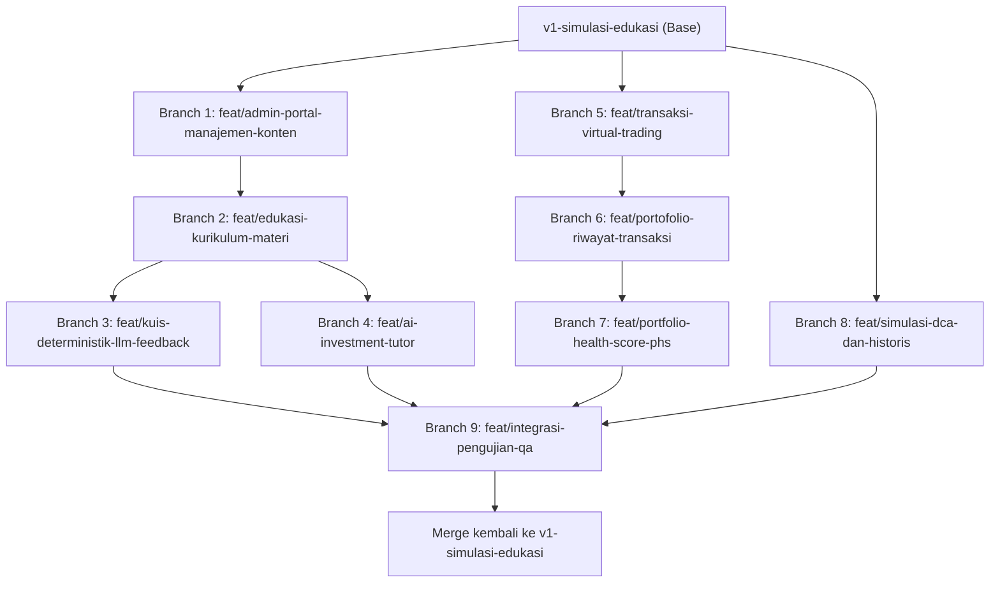

# DAFTAR STRUKTUR BRANCH PENGEMBANGAN
## Sub-Sistem Edukasi dan Simulasi Investasi Saham Berbasis Web
**Platform: AI-Powered Fundamental Investment Analyzer & Simulation**  
**Lead Developer:** Firman Farel Richardo (NPM 2315061099)  
**Base Branch:** `v1-simulasi-edukasi` (berbasis `main` dan telah digabungkan dengan `PRD-baru-19oct`)

---

## 1. Strategi & Alur Kerja Git (Branching Workflow)

Pengembangan sub-sistem edukasi dan simulasi dilakukan secara modular menggunakan pendekatan **Feature Branch Workflow** berbasis metodologi Agile/Scrum (4 Sprint). Setiap fitur dikembangkan pada branch terisolasi yang bercabang langsung dari branch induk `v1-simulasi-edukasi`, kemudian diintegrasikan kembali setelah melalui validasi fungsional dan pengujian QA.

```text
                                [v1-simulasi-edukasi] (Branch Induk)
                                         │
    ┌──────────────────┬─────────────────┼─────────────────┬──────────────────┐
    ▼                  ▼                 ▼                 ▼                  ▼
feat/admin-portal  feat/learning     feat/quiz-llm     feat/virtual-trade feat/portfolio-phs
 (Sprint 1)         (Sprint 2)        (Sprint 2)        (Sprint 3)         (Sprint 3)
```

---

## 2. Rincian Pembagian Branch Fitur

---

### BRANCH 1: `feat/admin-portal-manajemen-konten`
* **Sprint Terkait:** Sprint 1  
* **Relasi Kebutuhan & Backlog:** `KF-01`, `KF-16`, `KNF-01`, `PB-01`, `PB-12`, `PB-13`  
* **Tujuan Branch:** Membangun autentikasi berbasis peran (*Role-Based Access Control* / RBAC) serta antarmuka khusus Administrator untuk mengelola konten kurikulum materi edukasi dan bank soal kuis evaluasi.

#### A. Deskripsi Fitur:
1. **Autentikasi & Otorisasi RBAC**: Pembedaan hak akses antara `INVESTOR` dan `ADMINISTRATOR` menggunakan token JWT dan middleware `verifyAdmin`.
2. **Manajemen Modul Pembelajaran (Admin)**: CRUD modul materi mencakup judul, slug unik, level (`BEGINNER`, `INTERMEDIATE`, `ADVANCED`), estimasi waktu baca, urutan tampil (`order_index`), dan status terbit (`is_published`).
3. **Manajemen Kuis Evaluasi (Admin)**: CRUD bank soal kuis pilihan ganda yang terikat pada modul materi, mencakup teks pertanyaan, 4 pilihan jawaban (A, B, C, D), penentuan kunci jawaban resmi deterministik, teks pembahasan resmi, dan pemetaan indikator konsep materi.

#### B. Komponen Teknis:
- **Database/Prisma**: Tabel `users` (kolom `role`), `learning_modules`, dan `quiz_questions`.
- **Backend API**:
  - `POST /api/auth/admin/login`
  - `GET /api/admin/modules`, `POST /api/admin/modules`, `PUT /api/admin/modules/:id`, `DELETE /api/admin/modules/:id`
  - `GET /api/admin/modules/:id/quizzes`, `POST /api/admin/quizzes`, `PUT /api/admin/quizzes/:id`, `DELETE /api/admin/quizzes/:id`
- **Frontend Pages/Components**:
  - `AdminLoginPage.jsx`
  - `AdminDashboardPage.jsx`
  - `AdminModuleManagement.jsx` (Tabel modul & Modal Form Editor)
  - `AdminQuizManagement.jsx` (Editor butir soal, pilihan A-D, kunci, pembahasan, indikator)

#### C. Flow Ringkas:
```text
Admin Login ──> Verifikasi Role ADMIN ──> Dashboard Admin
   ├── [Pilih Manajemen Modul] ──> Tambah/Edit Modul ──> Simpan ke DB (Status Draft/Published)
   └── [Pilih Manajemen Kuis]  ──> Pilih Modul ──> Input Soal + Pilihan A-D + Kunci + Pembahasan + Indikator ──> Simpan
```

---

### BRANCH 2: `feat/edukasi-kurikulum-materi`
* **Sprint Terkait:** Sprint 2  
* **Relasi Kebutuhan & Backlog:** `KF-02`, `KF-03`, `KNF-04`, `PB-02`  
* **Tujuan Branch:** Menyediakan antarmuka pembelajaran terstruktur dalam 3 level bertingkat bagi pengguna (Investor) serta pencatatan kemajuan belajar (*learning progress tracking*) yang persisten.

#### A. Deskripsi Fitur:
1. **Katalog Roadmap 3 Tingkat Pembelajaran**:
   - **Level Pemula (*Beginner*)**: Pengenalan pasar modal, bursa efek IDX, konsep saham, lot (100 lembar), capital gain/loss, dividen, dan psikologi dasar.
   - **Level Menengah (*Intermediate*)**: Pengenalan laporan keuangan, analisis fundamental 4 pilar (Valuation, Profitability, Leverage, Growth), dan sentimen berita pasar.
   - **Level Mahir (*Advanced*)**: Manajemen risiko portofolio, diversifikasi aset, volatilitas imbal hasil, serta perbandingan strategi (DCA vs Lump Sum).
2. **Reader Artikel Edukasi**: Penampil materi berbasis markdown/teks kaya yang dilengkapi formula matematis, analogi visual, dan estimasi waktu baca.
3. **Pencatatan Progres Belajar Selesai**: Tombol *"Tandai Selesai Dibaca"* yang memperbarui status belajar pengguna secara persisten di database, tanpa terikat oleh nilai kuis.

#### B. Komponen Teknis:
- **Database/Prisma**: Tabel `learning_progress` (`user_id`, `module_id`, `is_completed`, `completed_at`).
- **Backend API**:
  - `GET /api/learning/modules` (Daftar modul 3 level + status progres user)
  - `GET /api/learning/modules/:slug` (Detail isi artikel materi)
  - `POST /api/learning/modules/:id/progress` (Tandai selesai membaca)
- **Frontend Pages/Components**:
  - `LearningCenterPage.jsx` (Roadmap 3 level & bar progres belajar)
  - `LearningModuleDetailPage.jsx` (Reader materi, breadcrumb, tombol selesai & aksi ke kuis)
  - `ProgressBarWidget.jsx`

#### C. Flow Ringkas:
```text
Investor Akses /learn ──> Sistem tampilkan daftar modul Level 1, 2, 3 beserta progres
   └── Investor pilih modul ──> Sistem muat isi materi artikel
        └── Investor membaca materi ──> Klik "Tandai Selesai" ──> Status completed tersimpan di DB
```

---

### BRANCH 3: `feat/kuis-deterministik-llm-feedback`
* **Sprint Terkait:** Sprint 2  
* **Relasi Kebutuhan & Backlog:** `KF-04`, `KF-05`, `KF-06`, `KF-17`, `PB-04`, `RQ2`  
* **Tujuan Branch:** Mengimplementasikan instrumen kuis evaluasi pilihan ganda yang dinilai secara deterministik oleh sistem berdasarkan kunci jawaban, dipadukan dengan **Evaluasi Pemahaman Berbantuan LLM** (analisis indikator konsep & umpan balik rekomendasi belajar).

#### A. Deskripsi Fitur:
1. **Antarmuka Pengerjaan Kuis Interaktif**: Soal pilihan ganda acak per modul dengan timer edukatif dan validasi kelengkapan jawaban sebelum pengiriman.
2. **Mesin Penilaian Deterministik Sistem**: Pencocokan jawaban terhadap kunci jawaban resmi di database, kalkulasi nilai instan (skala 0–100%), serta penyajian teks pembahasan resmi per butir soal.
3. **Evaluasi Pemahaman Berbantuan LLM (Google Gemini)**:
   - Backend merangkum payload konteks: soal, pilihan jawaban pengguna, kunci jawaban resmi, pembahasan resmi, dan pemetaan indikator materi.
   - LLM menghasilkan analisis kualitatif: konsep yang sudah dipahami, konsep yang belum tepat, dan modul materi rujukan yang perlu dipelajari kembali.
   - **Guardrail Integritas**: LLM dilarang memodifikasi nilai angka deterministik.
   - **Graceful Fallback**: Jika koneksi LLM timeout/gagal, nilai kuis dan pembahasan resmi tetap disajikan secara utuh tanpa error sistem.

#### B. Komponen Teknis:
- **Database/Prisma**: Tabel `quiz_attempts` (`user_id`, `module_id`, `score_percentage`, `answers_payload`, `ai_feedback_payload`).
- **Backend API**:
  - `GET /api/learning/modules/:id/quiz` (Ambil butir soal tanpa membocorkan kunci jawaban)
  - `POST /api/learning/modules/:id/quiz/submit` (Submit jawaban, penilaian deterministik + panggil Gemini API untuk feedback)
- **Frontend Pages/Components**:
  - `QuizModal.jsx` / `QuizExecutionPage.jsx` (Antarmuka pengerjaan soal A–D)
  - `QuizResultCard.jsx` (Skor deterministik 0–100% & status kelulusan)
  - `OfficialExplanationList.jsx` (Daftar pembahasan resmi per butir soal)
  - `AiFeedbackNarrativeCard.jsx` (Kartu evaluasi pemahaman konsep & modul rekomendasi dari LLM)

#### C. Flow Ringkas:
```text
Pengguna Mulai Kuis ──> Jawab Soal Pilihan Ganda A-D ──> Kirim Jawaban
   │
   ▼
Backend Deterministik:
 ├── Cocokkan jawaban dengan kunci ──> Hitung Nilai (0-100%) ──> Ambil Pembahasan Resmi
 │
 └── Context Injection ke LLM (Gemini):
      ├── Input: Soal + Jawaban User + Kunci + Pembahasan + Indikator Materi
      ├── Output LLM: Konsep dikuasai + Konsep belum tepat + Modul rekomendasi
      └── Fallback: Jika LLM gagal, tetap kembalikan nilai deterministik & pembahasan
   │
   ▼
Frontend menampilkan: Skor Nilai + Pembahasan Resmi + Umpan Balik AI Evaluator
```

---

### BRANCH 4: `feat/ai-investment-tutor`
* **Sprint Terkait:** Sprint 2  
* **Relasi Kebutuhan & Backlog:** `KF-07`, `PB-03`, `RQ1`  
* **Tujuan Branch:** Menyediakan asisten belajar virtual interaktif berbasis Google Gemini API yang terikat pada konteks modul edukasi untuk menjawab kebingungan konsep finansial pengguna secara terstruktur.

#### A. Deskripsi Fitur:
1. **Interactive Chat Assistant**: Widget percakapan asisten belajar yang dapat diakses langsung dari halaman edukasi maupun dashboard.
2. **Context-Grounded Tutor**: Setiap modul menyertakan konteks materi aktif ke prompt sistem AI sehingga tutor menjawab spesifik sesuai kurikulum sistem.
3. **Struktur Jawaban Bertahap**: Tutor menyusun respon dengan formula: *Definisi $\rightarrow$ Konsep/Rumus $\rightarrow$ Contoh Kasus Nyata $\rightarrow$ Cara Membaca $\rightarrow$ Catatan Risiko*.
4. **Guardrail Non-Finansial**: Larangan eksplisit memberikan rekomendasi beli/jual saham atau prediksi kepastian harga masa depan, disertai *disclaimer* edukasi otomatis.

#### B. Komponen Teknis:
- **Backend Services**: `TutorService.js` & `AIService.js` (Prompt engineering khusus persona tutor edukasi).
- **Backend API**: `POST /api/ai/tutor` (`{ question, current_module_slug, context_text }`).
- **Frontend Components**:
  - `AiTutorChatWidget.jsx` (Floating widget chat dengan animasi responsif)
  - `TutorMessageBubble.jsx` (Format markdown, math formula, dan prompt chips contoh pertanyaan)

#### C. Flow Ringkas:
```text
Investor ajukan pertanyaan di AI Tutor ("Apa maksud dari rasio DER 1.5x?")
   │
   ▼
Backend gabungkan: System Prompt Persona Tutor + Konteks Modul Terkait + Pertanyaan Investor
   │
   ▼
Gemini API menghasilkan penjelasan terstruktur (Definisi ──> Analogi ──> Cara Baca)
   │
   ▼
Frontend merender jawaban AI Tutor + Disclaimer Edukasi Non-Financial Advice
```

---

### BRANCH 5: `feat/transaksi-virtual-trading`
* **Sprint Terkait:** Sprint 3  
* **Relasi Kebutuhan & Backlog:** `KF-08`, `KF-09`, `KF-10`, `KNF-03`, `KNF-06`, `PB-05`, `PB-06`  
* **Tujuan Branch:** Membangun lingkungan simulasi perdagangan saham virtual Bursa Efek Indonesia (IDX) menggunakan **Modal Virtual Awal** dan eksekusi transaksi berbasis satuan lot penuh (1 lot = 100 lembar).

#### A. Deskripsi Fitur:
1. **Inisialisasi Saldo Modal Virtual**: Setiap akun Investor baru otomatis memiliki saldo kas virtual default (misal: Rp10.000.000).
2. **Informasi Harga Saham Acuan (Market Data)**: Mengambil harga penutupan atau terkini dari Yahoo Finance API sebagai referensi simulasi transaksi, disertai transparansi timestamp dan sumber data.
3. **Eksekusi Order Beli (BUY)**:
   - Validasi saldo kas: Total biaya = $\text{Lots} \times 100 \times \text{Harga Saham}$.
   - Jika saldo mencukupi: Saldo kas dipotong, kuantitas kepemilikan lot/lembar bertambah.
   - Jika saldo kurang: Transaksi ditolak dengan pesan error yang jelas.
4. **Eksekusi Order Jual (SELL)**:
   - Validasi kepemilikan lot aktif: Memastikan pengguna memiliki saham terkait $\ge$ jumlah lot yang hendak dijual (*no short selling*).
   - Jika valid: Saldo kas bertambah sebesar nilai penjualan, kuantitas kepemilikan lot berkurang.
5. **Penanda Visual Eksplisit**: Seluruh antarmuka menampilkan tanda tegas bahwa transaksi ini adalah *Simulasi Modal Virtual Tanpa Uang Riil*.

#### B. Komponen Teknis:
- **Database/Prisma**:
  - Tabel `users` (kolom `virtual_balance`).
  - Tabel `virtual_transactions` (`user_id`, `symbol`, `transaction_type`, `lots`, `shares`, `price_per_share`, `total_amount`, `transaction_date`).
  - Tabel `virtual_holdings` (`user_id`, `symbol`, `lots`, `shares`, `avg_buy_price`).
- **Backend API**:
  - `GET /api/virtual-trade/balance` (Ambil saldo kas virtual)
  - `POST /api/virtual-trade/execute` (Eksekusi BUY / SELL)
- **Frontend Pages/Components**:
  - `VirtualTradingModal.jsx` (Form order: Simbol, Tipe BUY/SELL, Slider/Input Lot, Kalkulasi Total Biaya)
  - `OrderSummaryCard.jsx`
  - `MarketPriceReferenceBadge.jsx` (Status sumber & waktu data harga)

#### C. Flow Ringkas:
```text
Investor buka form transaksi virtual ──> Pilih Saham (misal: BBCA) & Tipe Transaksi
   │
   ├── JIKA BUY:
   │    └── Input Lot ──> Backend cek: Apakah Saldo Kas >= (Lot * 100 * Harga)?
   │         ├── Ya ──> Kurangi Kas Virtual, Tambah Lot di Holdings, Catat Riwayat Transaksi
   │         └── Tidak ──> Tampilkan pesan "Saldo Modal Virtual Tidak Cukup"
   │
   └── JIKA SELL:
        └── Input Lot ──> Backend cek: Apakah user memiliki Lot tersebut?
             ├── Ya ──> Tambah Kas Virtual, Kurangi Lot di Holdings, Hitung Realized P/L
             └── Tidak ──> Tampilkan pesan "Kepemilikan Saham Tidak Mencukupi (No Short Selling)"
```

---

### BRANCH 6: `feat/portofolio-riwayat-transaksi`
* **Sprint Terkait:** Sprint 3  
* **Relasi Kebutuhan & Backlog:** `KF-11`, `KF-12`, `PB-08`, `PB-09`  
* **Tujuan Branch:** Menyediakan antarmuka ringkasan portofolio virtual pengguna, tabel kepemilikan aktif (*holdings*), kalkulasi laba/rugi, serta riwayat transaksi kronologis.

#### A. Deskripsi Fitur:
1. **Ringkasan Nilai Portofolio Virtual**:
   - Saldo Kas Virtual (*Cash Balance*).
   - Nilai Pasar Seluruh Saham (*Total Stock Equity*).
   - Nilai Total Portofolio ($V_t = \text{Kas} + \text{Nilai Saham}$).
   - Total Return (% dan Nominal Rp) serta akumulasi *Realized P/L* dan *Unrealized P/L*.
2. **Kalkulasi Rata-Rata Harga Beli (*Weighted Average Buy Price*)**:
   - Menghitung penyesuaian harga beli rata-rata tertimbang saat melakukan pembelian bertahap (*averaging up / averaging down*).
3. **Tabel Kepemilikan (*Holdings Table*)**: Daftar saham aktif, jumlah lot, jumlah lembar, avg price, harga pasar terkini, nilai modal, nilai pasar, dan floating P/L.
4. **Visualisasi Alokasi Sektoral & Aset**: Diagram donat/pie interaktif yang memetakan persentase bobot setiap saham dan sektor dalam portofolio.
5. **Tabel Riwayat Transaksi Kronologis**: Catatan lengkap seluruh aktivitas transaksi virtual (waktu, emiten, BUY/SELL, lot, harga, dan nominal total).

#### B. Komponen Teknis:
- **Backend Services**: `PortfolioService.js` (Agregasi holdings, kalkulasi avg buy price, realized/unrealized P/L).
- **Backend API**:
  - `GET /api/portfolio/summary`
  - `GET /api/portfolio/holdings`
  - `GET /api/portfolio/history`
- **Frontend Pages/Components**:
  - `VirtualPortfolioPage.jsx`
  - `PortfolioMetricCards.jsx` (Kas, Nilai Saham, Total Nilai, Return %)
  - `HoldingsTable.jsx`
  - `PortfolioAllocationChart.jsx` (Recharts Pie Chart)
  - `TransactionHistoryTable.jsx`

#### C. Flow Ringkas:
```text
Investor Akses Halaman Portofolio (/portfolio)
   │
   ▼
Backend memproses:
 ├── Ambil saldo kas + holdings aktif
 ├── Ambil harga pasar terkini per emiten ──> Hitung Nilai Pasar & Unrealized P/L
 ├── Hitung Total Portofolio Vt = Kas + Nilai Pasar Saham
 └── Hitung Realized P/L dari riwayat SELL
   │
   ▼
Frontend merender: Metric Summary Cards + Diagram Alokasi + Tabel Kepemilikan + Riwayat Transaksi
```

---

### BRANCH 7: `feat/portfolio-health-score-phs`
* **Sprint Terkait:** Sprint 3  
* **Relasi Kebutuhan & Backlog:** `KF-13`, `KF-14`, `PB-07`, `Rumus 2.1`, `Rumus 2.2`, `Rumus 2.3`, `RQ3`  
* **Tujuan Branch:** Merancang dan mengimplementasikan **Portfolio Health Score (PHS)** sebagai indikator evaluasi komposit kesehatan dan fluktuasi risiko portofolio virtual berdasarkan kombinasi Return on Investment (ROI) dan Volatilitas Imbal Hasil.

#### A. Deskripsi Fitur:
1. **Perekaman Snapshot Nilai Portofolio Periodik**: Pencatatan otomatis snapshot nilai total portofolio ($V_t$) pada interval harian/periodik yang konsisten ke tabel `portfolio_daily_snapshots`.
2. **Kalkulasi Indikator Performa (ROI - Rumus 2.1)**:
   $$\text{ROI} = \left( \frac{V_t - V_0}{V_0} \right) \times 100\%$$
   *(Di mana $V_0$ adalah modal awal virtual dan $V_t$ adalah nilai total portofolio saat evaluasi).*
3. **Kalkulasi Indikator Risiko (Volatilitas Imbal Hasil $s$ - Rumus 2.2 & 2.3)**:
   $$r_t = \left( \frac{V_t - V_{t-1}}{V_{t-1}} \right) \times 100\%, \quad s = \sqrt{\frac{\sum_{t=1}^n (r_t - \bar{r})^2}{n - 1}}$$
4. **Agregasi Komposit & Arah Kontribusi**:
   - Normalisasi ROI ke skala skor (arah positif: ROI tinggi $\rightarrow$ skor tinggi).
   - Normalisasi Volatilitas ke skala skor (arah terbalik: fluktuasi rendah $\rightarrow$ skor risiko tinggi).
   - Penggabungan skor berbobot komposit.
5. **Penegakan Aturan Kecukupan Data ($n \ge 2$)**:
   - Jika jumlah data imbal hasil periodik $n < 2$, sistem **tidak menghasilkan skor akhir komposit PHS**, melainkan menampilkan nilai indikator mentah yang ada disertai keterangan: *"Data riwayat belum mencukupi untuk evaluasi risiko (Minimal 2 periode imbal hasil)"*.
6. **Transparansi Edukatif**: Nilai mentah ROI (%) dan Volatilitas (%) selalu disajikan berdampingan dengan skor PHS agar pengguna memahami asal mula penilaian.

#### B. Komponen Teknis:
- **Database/Prisma**: Tabel `portfolio_daily_snapshots` (`user_id`, `snapshot_date`, `total_portfolio_value`, `cash_balance`, `stocks_market_value`, `period_return_pct`).
- **Backend Services**: `HealthScoreService.js` (Eksekusi Rumus 2.1, 2.2, 2.3, verifikasi data kecukupan, pembobotan indeks komposit).
- **Backend API**:
  - `GET /api/portfolio/health-score`
  - `POST /api/portfolio/snapshots/record` (Perekam snapshot otomatis/cron)
- **Frontend Pages/Components**:
  - `PortfolioHealthPage.jsx`
  - `HealthScoreGauge.jsx` (Gauge visual 0–100 atau kartu peringatan data belum cukup)
  - `PerformanceVsRiskCard.jsx` (Menampilkan ROI mentah vs Volatilitas berdampingan)
  - `PortfolioVolatilityTrendChart.jsx` (Grafik garis tren imbal hasil periodik)

#### C. Flow Ringkas:
```text
Investor Akses Menu Portfolio Health Score (/portfolio/health)
   │
   ▼
Backend HealthScoreService:
 ├── Ambil V0 (Modal Awal) dan Vt (Nilai Total Terkini) ──> Hitung ROI (Rumus 2.1)
 ├── Ambil riwayat snapshot harian dari DB
 ├── Periksa Syarat Kecukupan Data (n >= 2 periode):
 │    ├── JIKA n < 2:
 │    │    └── Return status DATA_INSUFFICIENT, kirim ROI mentah, skor PHS = null
 │    └── JIKA n >= 2:
 │         ├── Hitung imbal hasil periodik rt (Rumus 2.2)
 │         ├── Hitung simpangan baku sampel s (Rumus 2.3)
 │         ├── Normalisasi ROI (positif) & Volatilitas (arah terbalik)
 │         └── Hitung Skor Komposit Akhir PHS
   │
   ▼
Frontend merender: Meteran Skor PHS + Kartu ROI & Volatilitas + Penjelasan Evaluasi Edukatif
```

---

### BRANCH 8: `feat/simulasi-dca-dan-historis`
* **Sprint Terkait:** Sprint 4  
* **Relasi Kebutuhan & Backlog:** `KF-15`, `KF-18`, `PB-10`, `PB-11`, `RQ5`  
* **Tujuan Branch:** Menyediakan fitur komputasi simulasi skenario investasi berbasis data harga masa lalu (Backtesting), mencakup **Simulasi Investasi Historis (Lump Sum)** dan **Simulasi Dollar-Cost Averaging (DCA)** dengan *Realistic Lot Mode*, yang terisolasi penuh dari saldo transaksi virtual utama.

#### A. Deskripsi Fitur:
1. **Simulasi Investasi Historis (Lump Sum Skenario)**: Pengguna menentukan emiten saham, modal awal virtual, dan rentang tanggal masa lalu untuk melihat hasil investasi jika membeli sekaligus di masa lalu.
2. **Simulasi Dollar-Cost Averaging (Realistic Lot Mode)**:
   - Pengguna menentukan saham, budget bulanan (misal: Rp500.000), interval tanggal pembelian bulanan, dan durasi simulasi (6, 12, 24, 36 bulan).
   - **Aturan Lot Penuh (100 lembar)**: Pembelian hanya dilakukan dalam bilangan bulat non-negatif lot.
   - **Rollover Kas Bulanan**: Sisa dana kas yang belum cukup membeli 1 lot diakumulasikan ke modal bulan berikutnya.
   - **Penanganan Hari Libur Bursa**: Jika tanggal eksekusi jatuh pada hari libur bursa, pembelian menggunakan harga penutupan hari bursa aktif berikutnya (*next trading day*).
3. **Komparasi Kinerja**: Menampilkan perbandingan performa DCA terhadap pembelian Lump Sum, average cost per share, akumulasi lot, dan nilai portofolio akhir.
4. **Isolasi Saldo Virtual**: Komputasi simulasi ini berjalan murni sebagai skenario analitik dan **sama sekali tidak memotong kas virtual atau memodifikasi portofolio transaksi virtual utama pengguna**.

#### B. Komponen Teknis:
- **Backend Services**: `DCAService.js` & `HistoricalSimService.js`.
- **Backend API**:
  - `POST /api/simulation/historical` (`{ symbol, initial_capital, start_date, end_date }`)
  - `POST /api/simulation/dca` (`{ symbol, monthly_amount, period_months, execution_day }`)
- **Frontend Pages/Components**:
  - `DcaSimulatorPage.jsx`
  - `DcaParametersForm.jsx`
  - `DcaAccumulationChart.jsx` (Area Chart: Modal Disetor vs Nilai Portofolio dari bulan ke bulan)
  - `DcaMonthlyBreakdownTable.jsx` (Tabel detail bulanan: Harga, Dana Tersedia, Lot Dibeli, Sisa Kas Rollover)
  - `HistoricalSimulatorPage.jsx`

#### C. Flow Ringkas:
```text
Investor isi form DCA (Saham: BBCA, Budget: Rp500.000/bln, Durasi: 12 Bulan, Tgl: 1)
   │
   ▼
Backend DCAService (Loop Bulan 1 s.d. 12):
 ├── Dana Tersedia = Budget Bulanan + Sisa Kas Bulan Lalu
 ├── Harga 1 Lot = Harga Saham Hari Eksekusi * 100
 ├── Lot Dibeli = floor(Dana Tersedia / Harga 1 Lot)
 ├── Sisa Kas Rollover = Dana Tersedia - (Lot Dibeli * Harga 1 Lot)
 └── Simpan data timeline bulanan
   │
   ▼
Hitung Nilai Akhir = (Total Lembar Terkumpul * Harga Terkini) + Sisa Kas Terakhir
   │ (Penting: Saldo Virtual Transaksi Utama Pengguna Tetap Utuh 100%)
   ▼
Frontend merender: Kartu Ringkasan Hasil + Grafik Modal vs Portofolio + Tabel Rincian Tiap Bulan
```

---

### BRANCH 9: `feat/integrasi-pengujian-qa`
* **Sprint Terkait:** Akhir Sprint 4 / Tahap Pengujian Menyeluruh  
* **Relasi Kebutuhan & Backlog:** `Michael Defrans (QA Scope)`, Evaluasi Akhir Sempro  
* **Tujuan Branch:** Melakukan pengujian integrasi lintas modul, penjaminan kualitas (*Quality Assurance*), pengujian *edge-cases*, dan validasi skenario pengujian skripsi secara komprehensif sebelum rilis.

#### A. Deskripsi Fitur:
1. **Automated Unit & Integration Testing**:
   - Pengujian determinisme kuis: verifikasi bahwa nilai kuis 100% konsisten dengan kunci jawaban.
   - Pengujian isolasi LLM: memastikan LLM tidak pernah mengubah skor kuis dan sistem fallback berfungsi saat LLM dimatikan.
   - Pengujian validasi transaksi virtual: penolakan order BUY saat saldo kas kurang, penolakan order SELL saat lot saham tidak mencukupi (*no short selling*).
   - Pengujian PHS: validasi matematis Rumus 2.1, 2.2, 2.3 serta verifikasi bahwa skor komposit tidak muncul saat data $n < 2$.
   - Pengujian isolasi simulasi DCA: memastikan saldo modal virtual dan kepemilikan utama tidak berubah.
2. **Pengujian Non-Fungsional (KNF-01 s.d. KNF-06)**:
   - Pengujian keamanan token JWT dan proteksi endpoint Admin.
   - Pengujian responsivitas UI desktop dan mobile browser.
   - Verifikasi pencantuman penanda simulasi modal virtual dan transparansi sumber harga.

#### B. Komponen Teknis:
- **Test Suites**: Jest / Supertest untuk backend API testing, Postman Collection, Vitest / React Testing Library untuk frontend.
- **Reporting**: Lembar pengujian QA (Kode Kebutuhan, Skenario, Input, Expected Output, Actual Output, Status Lolos/Gagal).

---

## 3. Matriks Dependensi & Urutan Pengerjaan Branch

Untuk menjamin kelancaran integrasi dan meminimalkan konflik merge, pengerjaan branch disarankan mengikuti diagram dependensi berikut:



---

## 4. Panduan Teknis Pembuatan Branch Git

Gunakan perintah powershell/bash berikut untuk memulai pengerjaan branch yang diinginkan:

```powershell
# 1. Pastikan berada di branch utama simulasi-edukasi dan sinkron
git checkout v1-simulasi-edukasi
git pull origin v1-simulasi-edukasi

# 2. Buat dan masuk ke branch fitur baru (contoh untuk Branch 1)
git checkout -b feat/admin-portal-manajemen-konten

# 3. Lakukan commit berkala menggunakan format Conventional Commits
git commit -m "feat(admin): implement learning module management endpoints and schema"

# 4. Push branch ke remote saat siap diuji
git push -u origin feat/admin-portal-manajemen-konten
```

---

## 5. Ringkasan Keterkaitan dengan Sub-Sistem Analisis Saham (Fayiz Scope)

| Titik Temu Integrasi | Modul Sub-Sistem 1 (Fayiz) | Modul Sub-Sistem 2 (Firman) | Hubungan Integrasi |
|---|---|---|---|
| **Katalog Saham & Harga Acuan** | Market Data Service / Yahoo Finance | Transaksi Virtual & Simulasi DCA | Sub-sistem 2 mengonsumsi harga pasar terkini dari cache provider Sub-sistem 1 sebagai harga acuan eksekusi order. |
| **Navigasi Stock Detail** | Halaman Analisis Saham Emiten | Tombol Aksi *"Beli Virtual / Simulasi"* | Dari halaman analisis detail saham emiten, pengguna dapat langsung membuka modal transaksi virtual atau simulasi DCA untuk emiten tersebut. |
| **AI Orchestration** | Gemini API (Analisis Fundamental) | Gemini API (AI Tutor & Evaluasi Kuis) | Menggunakan konfigurasi environment key Google Gemini API yang sama dengan pemisahan system instruction dan payload builder. |
